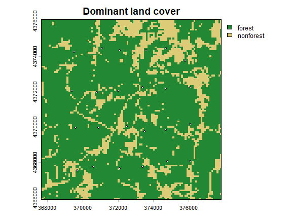
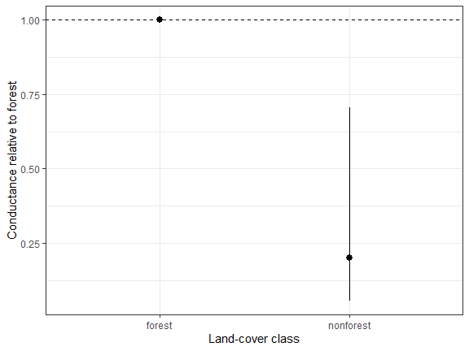
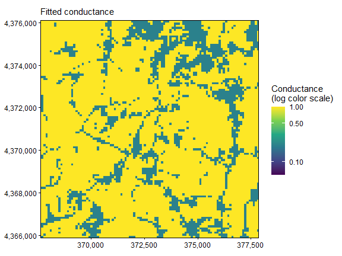
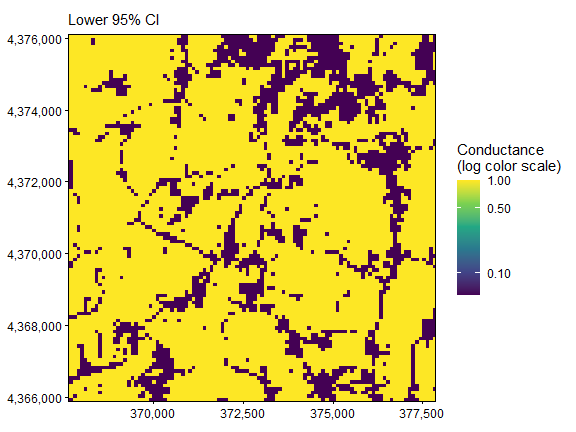
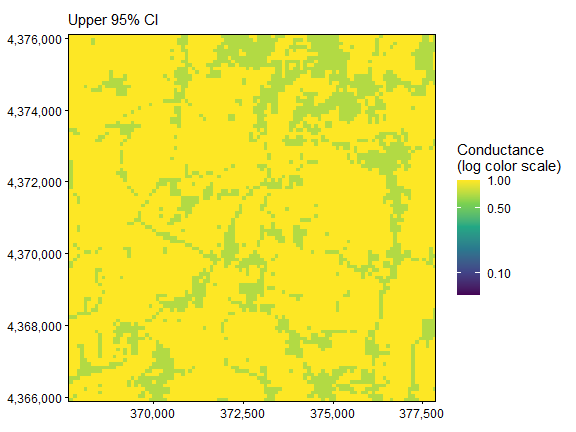

The displayed results and figures in this guide were computed from the
executable R Markdown source shipped with the package. Routine package
checks use these precomputed results to keep the CRAN check time modest.
To rerun every code chunk, copy `system.file("vignette-source", "categorical-conductance.Rmd", package = "terradish")` to a writable directory and render that copy with `rmarkdown::render()`.

---


**Goal.** Turn a land-cover code into a named class contrast, then interpret its conductance ratio.

This guide reuses the Ohio landscape and pond locations from
[`vignette("getting-started", package = "terradish")`](getting-started.html),
so start there if you are new to `terradish`.

## What does a categorical coefficient mean?

A land-cover class labels a type of cell rather than a position on a
continuous gradient. National Land Cover Database (NLCD) codes such as 41 (deciduous forest) and 82
(cultivated crops) are labels, so code 82 is not "twice" code 41. Store
nominal raster classes as factors, choose a reference class, and interpret
each coefficient as a conductance contrast relative to that reference.

The genetic response here is simulated directly from a known class effect,
not from the SLiM pond history, so you can check whether the fit recovers
it.

## Load a factor-valued raster


``` r
library(terradish)
library(terra)
library(ggplot2)
data(ohio_ponds)
ponds <- ohio_ponds$ponds
# The installed file contains a packed raster with embedded values and labels.
cover <- unwrap(readRDS(system.file("extdata", "ohio-ponds", "landcover100.rds",
                                   package = "terradish")))
levels(cover)
#> [[1]]
#>   ID     class
#> 1  1    forest
#> 2  2 nonforest
terra::freq(cover)
#>   layer     value count
#> 1     1    forest  8175
#> 2     1 nonforest  2229
```

**How to read the output.** This file groups the dominant native land
cover in each 100 m cell into `forest` (native codes 41, 42, 43, and 90)
and `nonforest`. A modal resample keeps nominal classes, unlike averaging
forest indicator cells, which estimates a continuous fraction. Grouping
all nonforest classes is a declared simplification, because water, roads,
cropland, and other open cells need not share biological resistance.

For your own raster, attach a class table (integer IDs, then labels) as in
the template below, and keep it with the raster so predictions and
checkpoints retain each class's meaning.


``` r
# Example only: attach the actual class table appropriate to your raster.
landcover <- terra::as.factor(your_landcover_raster)
levels(landcover) <- data.frame(ID = c(41, 71, 82),
                               class = c("forest", "grassland", "cropland"))
names(landcover) <- "landcover"
```

## Specify the reference and contrasts


``` r
# Scale the continuous slope layer; leave the nominal cover layer as a factor.
slope <- scale_covariates(unwrap(ohio_ponds$covariates)[["slope"]])
surface <- conductance_surface(c(cover, slope), ponds[c("x", "y")], directions = 8)
surface$x$landcover <- relevel(surface$x$landcover, ref = "forest")
contrasts(surface$x$landcover) <-
  contr.treatment(levels(surface$x$landcover), base = 1)
levels(surface$x$landcover)
#> [1] "forest"    "nonforest"
head(model.matrix(~ landcover, surface$x))
#>   (Intercept) landcovernonforest
#> 1           1                  0
#> 2           1                  0
#> 3           1                  0
#> 4           1                  0
#> 5           1                  0
#> 6           1                  0
```

**How to read the output.** Treatment coding makes forest the reference
and adds one indicator column for nonforest, so $K$ classes give $K-1$
contrasts. The intercept in `model.matrix()` only shows the coding
convention. The fitted conductance model drops the overall conductance
intercept, because the measurement scale absorbs that arbitrary
multiplier.

All sampled ponds are forest-screened, but the graph also contains
nonforest matrix cells. The class effect is inferred through paths among
ponds, not by regressing genetic response on each pond's land-cover label.
How well each class is represented across the graph, and where alternate
routes run, determine how well this contrast can be estimated.


``` r
terra::plot(cover, col = c("#228833", "#DDCC77"), main = "Dominant land cover")
points(ponds$x, ponds$y, pch = 21, bg = "white", cex = 0.6)
```



## Generate a specified covariance example

The known nonforest/forest conductance ratio is $\exp(-1)$, about 0.37.
`simulate_covariance_response()` builds the model covariance from that
conductance surface, then draws a noisy sample covariance from it. Larger
`nu` (here 120) gives a response closer to the true covariance.


``` r
benchmark <- simulate_covariance_response(
  theta = c(landcovernonforest = -1), formula = ~ landcover, data = surface,
  tau = 1, sigma = 0.02, nu = 120, seed = 61303)
S <- benchmark$covariance
```

The simulator's `sigma = 0.02` is the nugget **variance itself**, whereas
the fitted measurement `sigma` is its log. Slope has no effect in this
simulation.

## Fit and interpret the class contrast


``` r
control <- NewtonRaphsonControl(maxit = 200, ctol = 1e-8, ftol = 1e-8)
fit <- terradish(S ~ landcover, surface,
  measurement_model = wishart_covariance, nu = 120,
  optimizer = "bfgs", control = control)
summary(fit)
#> Conductance surface with 10404 vertices (24 focal) estimated by maximum likelihood
#> Call:   terradish(formula = S ~ landcover, data = surface, measurement_model = wishart_covariance,
#>     nu = 120, optimizer = "bfgs", control = control)
#>
#> Loglikelihood: 974.5133 (3 degrees freedom)
#> AIC: -1943.027
#>
#> Number of function calls: 14
#> Number of optimization steps: 6
#> Convergence: converged | projected gradient: 5.01e-13
#> Norm of gradient at MLE: 5.011068e-13
#>
#> Nuisance parameters (conditional on fitted conductance surface; measurement-model scale):
#>        Estimate  Std. Error  Lower 95%  Upper 95%
#> tau     0.7806    0.0820      0.6199     0.9413
#> sigma  -3.2267    0.3417     -3.8965    -2.5569
#>
#> Coefficients:
#>                    Estimate Std. Error z value Pr(>|z|)
#> landcovernonforest  -1.6021     0.6395  -2.505   0.0122 *
#> ---
#> Signif. codes:  0 '***' 0.001 '**' 0.01 '*' 0.05 '.' 0.1 ' ' 1
ratio <- exp(coef(fit)[["landcovernonforest"]])
data.frame(contrast = "nonforest / forest", conductance_ratio = ratio,
           percent_change = 100 * (ratio - 1))
#>             contrast conductance_ratio percent_change
#> 1 nonforest / forest         0.2014682      -79.85318
exp(confint(fit))
#>                         2.5 %    97.5 %
#> landcovernonforest 0.05752426 0.7056056
```

**How to read the output.** The model is

$$\log C_i=\beta_{\mathrm{nonforest}}\,
  \mathbf{1}(\mathrm{class}_i=\mathrm{nonforest}).$$

Forest, the reference class, has conductance one, and nonforest has
conductance $\exp(\beta_{\mathrm{nonforest}})$, so a negative coefficient
gives a ratio below one. Here the estimated nonforest/forest ratio is
0.20: nonforest cells conduct about
80% less than forest cells, with a 95% interval
for the ratio of 0.06 to 0.71.
That interval contains the true ratio of 0.37, so the fit recovers the
simulated class effect. The ratio is a contrast in graph conductance, not
the fraction of animals that cross open habitat.

| Parameter | Where it appears | What it measures |
|---|---|---|
| `landcovernonforest` | `coef(fit)` | Log conductance of nonforest relative to forest; exponentiate for the ratio |
| `slope` in a mixed candidate | `coef(fit)` | Change in log conductance per SD of slope, within a class |
| `tau` | `summary(fit)$phi` | Weight of the graph covariance (true value 1) |
| Measurement `sigma` | `summary(fit)$phi`, log scale | Log of the extra variance added to each pond (true variance 0.02) |

In an interaction model such as `landcover * slope`, each class contrast
applies at slope zero (the full-domain mean after standardization), and
the interaction lets the slope association differ by class. Fit such a
model only when the design can identify those extra parameters.

## Plot a class contrast and its map

The package's `type = "marginal"` plot skips factor predictors, so plot
the estimated class ratio directly. A line between forest and nonforest
would have no meaning.


``` r
ci <- exp(confint(fit))
classes <- data.frame(class = c("forest", "nonforest"),
  estimate = c(1, ratio), lower = c(1, ci[1, 1]), upper = c(1, ci[1, 2]))
ggplot(classes, aes(class, estimate)) +
  geom_hline(yintercept = 1, linetype = 2) +
  geom_pointrange(aes(ymin = lower, ymax = upper)) +
  theme_bw() + labs(x = "Land-cover class", y = "Conductance relative to forest")
```



**How to read the plot.** A ratio below one means nonforest conducts less
than forest. The reference has no interval because it defines the scale.


``` r
maps <- plot(fit, type = "surface", data = surface)
C <- conductance(surface, fit)
map_limits <- range(terra::values(C), na.rm = TRUE)

# Keep all cells and share limits across the estimate and both bounds.
for (p in maps) {
  print(p + scale_fill_viridis_c(
    trans = "log10", limits = map_limits,
    breaks = c(0.01, 0.1, 0.5, 1, 2, 5, 10, 20),
    name = "Conductance\n(log color scale)"
  ))
}
```







The log color limits are shared by the three panels of this fit only, so
check the legend before comparing models. The factor map has
abrupt class boundaries and does not describe smooth transitions or
variation within a class. `conductance(surface, fit)` returns the same
estimates and bounds as raster layers for further mapping.

## Verify what changing the reference does


``` r
other_reference <- surface
other_reference$x$landcover <- relevel(surface$x$landcover, ref = "nonforest")
contrasts(other_reference$x$landcover) <-
  contr.treatment(levels(other_reference$x$landcover), base = 1)
fit_reverse <- terradish(S ~ landcover, other_reference,
  measurement_model = wishart_covariance, nu = 120,
  optimizer = "bfgs", control = control)
stopifnot(fit_reverse$convergence$code == 0,
          fit_reverse$fit$subproblem$convergence == 0)
c(nonforest_over_forest = exp(coef(fit)[["landcovernonforest"]]),
  forest_over_nonforest = exp(coef(fit_reverse)[["landcoverforest"]]))
#> nonforest_over_forest forest_over_nonforest
#>             0.2014682             4.9635621
c(maximum_fitted_covariance_difference =
    max(abs(fitted(fit) - fitted(fit_reverse))))
#> maximum_fitted_covariance_difference
#>                         6.031287e-14
```

**How to read the output.** Reversing the reference flips the contrast's
label and sign, so the ratios are approximately reciprocals. The fitted
genetic covariance should agree within optimization precision once the
measurement scale adjusts. A reference class is a coding convention, not a
claim that its absolute conductance is biologically known.

## Evaluate class and continuous candidates on the same folds


``` r
cv <- terradish_cv_folds(surface,
  list(uniform = S ~ 1, categorical = S ~ landcover,
       mixed = S ~ landcover + slope),
  folds = ponds$fold, model = wishart_covariance, nu = 120,
  nuisance = "fixed", optimizer = "bfgs", keep_fits = "none", control = control)
stopifnot(all(cv$results$error == ""),
          all(cv$results$nuisance_iterations == 0))
cv$summary
#>         model folds failed n_folds_ok total_loglik common_folds_total
#> 1 categorical     3      0          3     957.0979           957.0979
#> 2     uniform     3      0          3     956.1142           956.1142
#> 3       mixed     3      0          3     955.0624           955.0624
#>   n_common_folds between_repeat_sd mean_loglik total_loglik_gain
#> 1              3                NA    319.0326         0.9837159
#> 2              3                NA    318.7047         0.0000000
#> 3              3                NA    318.3541        -1.0517992
#>   mean_loglik_gain se_difference mean_difference within_one_se
#> 1        0.3279053     0.0000000       0.0000000          TRUE
#> 2        0.0000000     0.7541902      -0.3279053          TRUE
#> 3       -0.3505997     0.8614202      -0.6785050          TRUE
```

**How to read the table.** Larger held-out log-likelihood is better. The
categorical model scores highest, but only
0.98
units above uniform conductance summed over three blocks, and both
`uniform` and `mixed` are `within_one_se` of it. With 24 ponds, held-out
prediction cannot distinguish this class effect from uniform conductance,
even though the full-data interval recovers it. Adding slope lowers
prediction, as expected for a covariate with no simulated effect. Every
fold keeps the full landscape graph, so both classes stay present and only
the scored ponds change.

## Smoothing land-cover classes

Do not Gaussian-smooth integer class codes (the Gaussian conductance
model rejects factors). If forest **context** is the question, derive a
forest indicator or fraction and smooth that continuous quantity, as in
[`vignette("gaussian-scale-optimization", package = "terradish")`](gaussian-scale-optimization.html).
For several class proportions that sum to one, omit a reference class or
otherwise address their exact linear dependence. Including every
proportion plus a redundant intercept leaves the contrasts unidentifiable.

<details>
<summary>Quick reference: expand for the complete copyable workflow</summary>

## Quick reference: a categorical conductance workflow


``` r
library(terradish)
library(terra)
data(ohio_ponds)
# 1. Retain category labels; the file embeds both values and the class table.
cover <- unwrap(readRDS(system.file("extdata", "ohio-ponds", "landcover100.rds",
                                   package = "terradish")))
graph <- conductance_surface(cover, ohio_ponds$ponds[c("x", "y")])
graph$x$landcover <- relevel(graph$x$landcover, ref = "forest")
contrasts(graph$x$landcover) <- contr.treatment(levels(graph$x$landcover), base = 1)

# 2. Make the response explicit: this benchmark is not SLiM genotype data.
S <- simulate_covariance_response(c(landcovernonforest = -1), ~ landcover,
  graph, tau = 1, sigma = 0.02, nu = 120, seed = 61303)$covariance

# 3. Fit a class contrast, then exponentiate to a relative conductance ratio.
fit <- terradish(S ~ landcover, graph,
  measurement_model = wishart_covariance, nu = 120, optimizer = "bfgs",
  control = NewtonRaphsonControl(maxit = 200, ctol = 1e-8, ftol = 1e-8))
fit$convergence
fit$fit$subproblem$convergence
exp(coef(fit))
exp(confint(fit))

# 4. Evaluate prediction with whole ponds held out and fixed test parameters.
cv <- terradish_cv_folds(graph, list(categorical = S ~ landcover),
  folds = ohio_ponds$ponds$fold, model = wishart_covariance, nu = 120,
  nuisance = "fixed", optimizer = "bfgs",
  control = NewtonRaphsonControl(maxit = 200, ctol = 1e-8, ftol = 1e-8))
cv$summary
```

</details>

## Summary of key functions

| Function | Purpose |
|---|---|
| `terra::as.factor()` and `levels()` | Preserve nominal raster classes and labels |
| `relevel()` and `contr.treatment()` | Specify reference classes and contrast coding |
| `model.matrix()` | Inspect the indicator columns used in a formula |
| `simulate_covariance_response()` | Create an explicit statistical covariance example |
| `terradish()` | Fit the class-based conductance hypothesis |
| `exp(coef())` and `exp(confint())` | Express log contrasts as conductance ratios |
| `terradish_cv_folds()` | Compare predictions on common held-out sites |

## See also

- [`vignette("getting-started", package = "terradish")`](getting-started.html): genotype
  construction, graph, and measurement parameters.
- [`vignette("gaussian-scale-optimization", package = "terradish")`](gaussian-scale-optimization.html):
  estimate the context of continuous forest fraction.
- [`vignette("spline-conductance", package = "terradish")`](spline-conductance.html): response
  shape for continuous covariates.
- [`vignette("model-comparison", package = "terradish")`](model-comparison.html):
  ranking candidate formulas by AIC, likelihood-ratio tests, and prediction.
- [`vignette("simulation-design", package = "terradish")`](simulation-design.html):
  simulating responses with `simulate_covariance_response()` to plan a study.
- `?conductance_surface`: factor-valued raster support and graph metadata.
