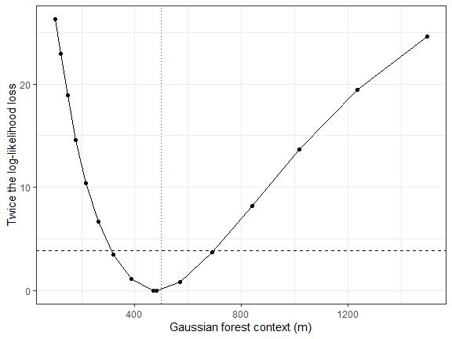
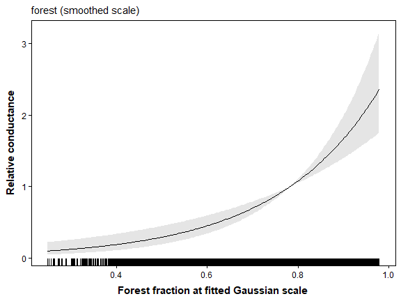
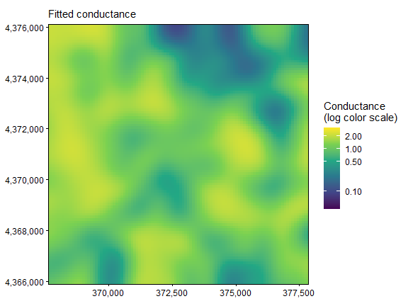
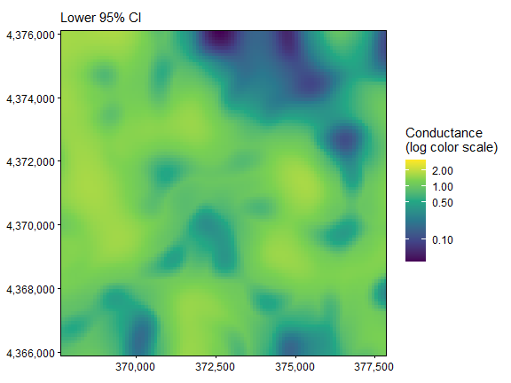
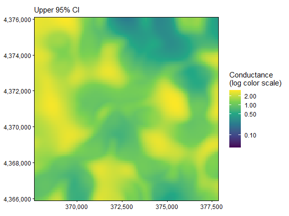
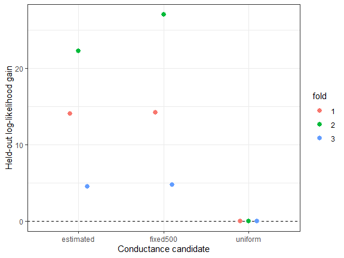

The displayed results and figures in this guide were computed from the
executable R Markdown source shipped with the package. Routine package
checks use these precomputed results to keep the CRAN check time modest.
To rerun every code chunk, copy `system.file("vignette-source", "gaussian-scale-optimization.Rmd", package = "terradish")` to a writable directory and render that copy with `rmarkdown::render()`.

---


**Goal.** Estimate the forest neighborhood in meters, read its uncertainty, and compare its predictions with those of a fixed neighborhood.

[`vignette("data-generation", package = "terradish")`](data-generation.html)
explains the landscapes, SLiM histories, sampling, and matched markers used
in these examples.

## What question does a Gaussian scale answer?

A single 100 m cell may not capture the forest context that matters to
gene exchange. A Gaussian smoother averages neighboring cells, weighting
nearer cells more, and its standard deviation, $\sigma_{\mathrm{forest}}$,
sets how broadly forest is averaged. `terradish` estimates that scale
jointly with the conductance association. Start with
[`vignette("getting-started", package = "terradish")`](getting-started.html)
for genotype construction and the resistance-graph workflow.

This guide uses the same 24 Ohio ponds and 2,500 SNPs, simulated with a
500 m forest context (five cells on the 100 m grid). Do the genetic data
support a similar context, and does estimating it improve prediction? The
smoothing scale describes a raster transformation in this model, not
necessarily a dispersal distance, home range, or barrier width.

<details>
<summary>Optional: what the Gaussian smoother computes</summary>

For each candidate scale, the model smooths the raw forest fraction and
standardizes the result over the retained landscape:

$$
\bar f_{i,\sigma} = \frac{\sum_j w_{ij}(\sigma)f_j}
 {\sum_j w_{ij}(\sigma)},\qquad
w_{ij}(\sigma) \propto \exp\left(-\frac{d_{ij}^2}{2\sigma^2}\right),
\qquad C_i = \exp(\theta_{\mathrm{forest}}z_{i,\sigma}).
$$

Here $f_j$ is raw forest fraction, $d_{ij}$ is map distance between cells,
and $z_{i,\sigma}$ is the standardized smoothed value. The kernel is finite
and its available weights are renormalized, so boundary behavior and raster
extent matter. The simulation used the same convention.

</details>

## Rebuild the shared response and graph


``` r
library(terradish)
library(terra)
library(ggplot2)
data(ohio_ponds)
ponds <- ohio_ponds$ponds
samples <- ohio_ponds$samples
groups <- factor(samples$pond, levels = ponds$pond)
N <- 2 * as.numeric(table(groups))
stopifnot(all(N == N[1]))
S <- cov_from_biallelic(rowsum(ohio_ponds$snp, groups, reorder = FALSE)[ponds$pond, , drop = FALSE], N) / N[1]

# Retain raw forest for estimated smoothing, and the known fixed context
# for a comparison on the identical graph. Neither layer is standardized here.
x <- c(unwrap(ohio_ponds$covariates)[["forest"]],
       unwrap(ohio_ponds$forest500))
surface <- conductance_surface(x, ponds[c("x", "y")], directions = 8)
terra::res(x)
#> [1] 100 100
range(terra::values(x[["forest"]]))
#> [1] 0 1
```

**How to read the output.** Map units are meters, and raw forest is a
fraction from 0 to 1. Supply it unsmoothed, because the Gaussian model
smooths and standardizes it at every candidate scale, and pre-smoothing
would change the scale being estimated. Skip `scale_covariates()`, which
would give the same fit and obscure the units.

The fixed `forest500` layer stays on its **raw fraction** scale, so its
coefficient is per unit fraction, while the Gaussian coefficient is per
one SD after smoothing. Both models share the response and graph, so their
fit and predictive scores remain comparable.

## Set interpretable scale bounds and fit


``` r
gaussian_model <- gaussian_smoothed_loglinear_conductance(surface,
  scale_vars = "forest", sigma_lower = 100, sigma_upper = 1500)
control <- NewtonRaphsonControl(maxit = 200, ctol = 1e-8, ftol = 1e-8)

fit_gaussian <- terradish(S ~ forest, surface,
  conductance_model = gaussian_model,
  measurement_model = wishart_covariance, nu = 40,
  theta = c(forest = 1, sigma.forest = 500),
  optimizer = "bfgs", control = control)
summary(fit_gaussian)
#> Conductance surface with 10404 vertices (24 focal) estimated by maximum likelihood
#> Call:   terradish(formula = S ~ forest, data = surface, conductance_model = gaussian_model,
#>     measurement_model = wishart_covariance, nu = 40, theta = c(forest = 1,
#>         sigma.forest = 500), optimizer = "bfgs", control = control)
#>
#> Loglikelihood: 141.3347 (4 degrees freedom)
#> AIC: -274.6694
#>
#> Number of function calls: 24
#> Number of optimization steps: 9
#> Convergence: converged | projected gradient: 4.65e-10
#> Norm of gradient at MLE: 4.653653e-10
#>
#> Gaussian scales (map units; no Wald test against zero):
#>   layer estimate       SE lower_bound upper_bound near_bound
#>  forest 480.0157 93.70678         100        1500      FALSE
#> near_bound marks estimates within 1% of a bound.
#>
#> Nuisance parameters (conditional on fitted conductance surface; measurement-model scale):
#>        Estimate  Std. Error  Lower 95%  Upper 95%
#> tau     1.4993    0.1908      1.1254     1.8731
#> sigma  -3.3796    0.7236     -4.7977    -1.9614
#>
#> Coefficients:
#>              Estimate Std. Error z value Pr(>|z|)
#> forest         0.5884     0.1039    5.66 1.51e-08 ***
#> sigma.forest 480.0157    93.7068      NA       NA
#> ---
#> Signif. codes:  0 '***' 0.001 '**' 0.01 '*' 0.05 '.' 0.1 ' ' 1
#>
#> Correlation of Coefficients:
#>                  forest
#> sigma.forest -0.3940096
fit_gaussian$convergence
#> $code
#> [1] 0
#>
#> $message
#> [1] "converged"
#>
#> $iterations
#> [1] 9
#>
#> $max_abs_projected_gradient
#> [1] 4.653466e-10
#>
#> $criterion
#> [1] "projected_gradient"
#>
#> $boundary
#> [1] FALSE
#>
#> $restarted
#> [1] FALSE
fit_gaussian$fit$subproblem$convergence
#> [1] 0
```

The 100 to 1,500 m bounds span one to 15 cells and include the simulated
context. Set bounds from the raster resolution, domain, and question
before interpreting the fit. Scales much smaller than a cell are hard to
distinguish, and very broad scales flatten local variation. An estimate at
a bound calls for checking identification and the landscape, not for
reporting an ecological threshold.

**How to read the output.** Both convergence codes should be zero. The
table below locates each parameter. Each smoothed layer gets a scale named
`sigma.<layer>`, in meters. Do not confuse `sigma.forest` with the
measurement parameter `sigma`.

| Parameter | Where it appears | What it measures |
|---|---|---|
| `forest` (theta) | `coef(fit_gaussian)` | Change in log conductance per SD of smoothed forest |
| `sigma.forest` | `coef(fit_gaussian)`, meters | Width of the forest neighborhood (Gaussian sigma) |
| `tau` | `summary(fit_gaussian)$phi` | Weight of the graph covariance |
| `sigma` | `summary(fit_gaussian)$phi`, log scale | Log of the extra variance added to each pond |
| `nu` | Supplied by you | Assumed information in `S`, here 40 |


``` r
scale_table <- gaussian_scale_summary(fit_gaussian, probabilities = c(0.5, 0.9))
scale_table
#>   covariate    sigma sigma_lower sigma_upper sigma_internal sigma_conversion
#> 1    forest 480.0157         100        1500       4.800157              100
#>   sigma_conversion_mode native_unit sigma_cells_x sigma_cells_y  axis_50
#> 1                  cell   map_units      4.800157      4.800157 323.7657
#>   radial_50  axis_90 radial_90
#> 1  565.1753 789.5556  1030.097
c(estimated_context_m = coef(fit_gaussian)[["sigma.forest"]],
  simulated_context_m = ohio_ponds$simulation$forest_sigma_m,
  conductance_ratio_per_SD = exp(coef(fit_gaussian)[["forest"]]))
#>      estimated_context_m      simulated_context_m conductance_ratio_per_SD
#>               480.015731               500.000000                 1.801026
```

**How to read the scale summary.** The fitted scale is sigma =
480 m
(4.8 cells), close to the simulated
500 m. Half of the kernel weight lies within
565 m of a cell (`radial_50`) and 90% within
1030 m (`radial_90`), so each cell's smoothed
forest value mostly reflects forest within about
1 km. The forest coefficient is on
the log scale: a cell one SD above the landscape average has
1.8 times the conductance of
an average cell.

This fit starts at 500 m. With your own data, try several starting scales
across the bounds, record their convergence, and resolve any
log-likelihood disagreement before you interpret a profile.

<details>
<summary>Optional: axis and radial distances are different summaries</summary>

`sigma_cells_x` and `sigma_cells_y` express the estimate in raster cells.
`axis_*` distances hold the stated central probability of an ideal
one-dimensional Gaussian, and `radial_*` distances hold it within a circle
for an ideal two-dimensional Gaussian:

$$d_{\mathrm{axis},p}=\sigma\Phi^{-1}((1+p)/2),\qquad
d_{\mathrm{radial},p}=\sigma\sqrt{-2\log(1-p)}.$$

At 90%, the radial distance is about $2.146\sigma$ and the axis distance
about $1.645\sigma$. Both describe an ideal kernel, not movement quantiles
or the weights retained where a raster boundary clips the kernel.

</details>

## Inspect scale uncertainty with a likelihood profile

A standard error assumes symmetric uncertainty, so it can miss a lopsided
likelihood or an estimate near a bound. A likelihood profile instead fixes
the scale at a series of values and reoptimizes all other parameters at
each one.


``` r
profile <- gaussian_scale_profile(fit_gaussian, "forest", n = 15)
profile$interval
#>    lower    upper
#> 310.9080 697.2514

# The returned fit stores this profile interval for its scale parameter.
profile_fit <- profile$fit
confint(profile_fit)
#>                    2.5 %      97.5 %
#> forest         0.3846334   0.7920802
#> sigma.forest 310.9080153 697.2513966
#> attr(,"note")
#> [1] "Stored Gaussian profile intervals are used where available; remaining scale intervals are truncated Wald intervals."
```

**How to read the interval.** The 95% profile interval runs from about
311 to
697 m under `nu = 40` and contains the
simulated 500 m. It extends farther above the estimate than below, so
report this interval, not a standard error, for scale. An endpoint at `sigma_lower` or `sigma_upper` means the data cannot
exclude scales beyond that bound. If any profile point fails to converge or
finds a better optimum than the fit, refit before you report the interval.


``` r
profile_plot <- transform(profile$grid,
  loss = 2 * (as.numeric(logLik(fit_gaussian)) - logLik))
ggplot(profile_plot, aes(sigma, loss)) +
  geom_line() + geom_point(size = 1.5) +
  geom_hline(yintercept = qchisq(0.95, 1), linetype = 2) +
  geom_vline(xintercept = 500, color = "#0072B2", linetype = 3) +
  theme_bw() + labs(x = "Gaussian forest context (m)",
                    y = "Twice the log-likelihood loss")
```



**How to read the plot.** A clear interior minimum means these data can
distinguish the forest scale. A flat curve would mean many scales have
similar support. The grid traces the shape, but the interval endpoints come
from additional fits. Because broader context also changes the raster SD,
interpret the conductance coefficient jointly with scale.


``` r
plot(profile_fit, type = "sigma") +
  labs(x = "Distance (m)") +
  theme(plot.margin = margin(6, 18, 6, 6))
```


## View conductance at the fitted scale

The kernel plot shows the neighborhood used to smooth forest. The marginal
plot shows how forest, averaged over that neighborhood, relates to fitted
conductance.


``` r
plot(profile_fit, type = "marginal", data = surface,
     marginal_covariates = "forest") +
  labs(x = "Forest fraction at fitted Gaussian scale", y = "Relative conductance")
```



**How to read the curve.** Its shape describes forest amount, while `sigma`
describes how broadly forest was averaged. The band conditions on the fitted
sigma, so it omits scale uncertainty, which the profile above addresses.


``` r
maps <- plot(profile_fit, type = "surface", data = surface)
C <- conductance(surface, profile_fit)
map_limits <- range(terra::values(C), na.rm = TRUE)

# Keep all cells and share limits across the estimate and both bounds.
for (p in maps) {
  print(p + scale_fill_viridis_c(
    trans = "log10", limits = map_limits,
    breaks = c(0.01, 0.1, 0.5, 1, 2, 5, 10, 20),
    name = "Conductance\n(log color scale)"
  ))
}
```







As in Getting Started, the three panels share one logarithmic color scale.
The broad pattern matches the fixed 500 m map there, as expected from a
fitted scale near 500 m.

## Compare estimated and fixed context


``` r
fit_uniform <- terradish(S ~ 1, surface,
  measurement_model = wishart_covariance, nu = 40,
  optimizer = "bfgs", control = control)
fit_fixed <- terradish(S ~ forest500, surface,
  measurement_model = wishart_covariance, nu = 40,
  optimizer = "bfgs", control = control)
aic_table(list(fit_uniform, fit_fixed, fit_gaussian),
  mod_names = c("uniform", "fixed500", "estimated"))
#>       model K       AIC Delta_AIC AIC_wt Cum.wt   loglik converged boundary
#> 2  fixed500 3 -276.6249    0.0000 0.7267 0.7267 141.3124      TRUE    FALSE
#> 3 estimated 4 -274.6694    1.9555 0.2733 1.0000 141.3347      TRUE    FALSE
#> 1   uniform 2 -203.5238   73.1011 0.0000 1.0000 103.7619      TRUE    FALSE
```

**How to read the table.** Both forest models beat uniform conductance by
more than 70 AIC units. The estimated-scale model nearly matches the
log-likelihood of the true 500 m layer, so its `Delta_AIC` of about 2 is
the penalty for one extra parameter. Models within 2 AIC units of the best
have comparable support. With field data the true scale is unknown, which
is why you estimate it.

## Evaluate prediction in whole held-out ponds

The three provided blocks keep whole ponds together, because an ordinary
pairwise split would leak shared-site information. First verify that no
immediate pedigree relationships cross blocks. If any do, redefine the
blocks or purge related training samples before fitting.


``` r
animal_fold <- ponds$fold[match(samples$pond, ponds$pond)]
relations <- lapply(seq_len(nrow(samples)), function(i)
  setdiff(unlist(samples[i, c("pedigree_id", "parent_1", "parent_2")]), -1))
cross_block_kin <- sum(vapply(seq_len(nrow(samples) - 1L), function(i) {
  j <- seq.int(i + 1L, nrow(samples))
  sum(vapply(j[animal_fold[j] != animal_fold[i]], function(k)
    length(intersect(relations[[i]], relations[[k]])) > 0, logical(1)))
}, integer(1)))
cross_block_kin
#> [1] 0
```

The count is zero here. It covers only known immediate pedigree
relationships, not deeper genetic independence. The blocks were fixed
before fitting and are reused for every candidate.


``` r
cv <- terradish_cv_folds(surface,
  formulas = list(uniform = S ~ 1, fixed500 = S ~ forest500,
                  estimated = S ~ forest),
  folds = ponds$fold, model = wishart_covariance, nu = 40,
  conductance_model = list(uniform = loglinear_conductance,
    fixed500 = loglinear_conductance, estimated = gaussian_model),
  nuisance = "fixed", keep_fits = "none", control = control)
stopifnot(all(cv$results$error == ""),
          all(cv$results$nuisance_iterations == 0))
cv$results[, c("model", "fold", "n_train", "n_test", "loglik",
               "loglik_gain", "nuisance_iterations", "error")]
#>       model fold n_train n_test     loglik loglik_gain nuisance_iterations
#> 1   uniform    3      14     10  58.752411    0.000000                   0
#> 2   uniform    1      17      7  68.908763    0.000000                   0
#> 3   uniform    2      17      7 -33.318439    0.000000                   0
#> 4  fixed500    3      14     10  63.474314    4.721903                   0
#> 5  fixed500    1      17      7  83.096136   14.187373                   0
#> 6  fixed500    2      17      7  -6.286712   27.031727                   0
#> 7 estimated    3      14     10  63.229022    4.476610                   0
#> 8 estimated    1      17      7  82.949304   14.040541                   0
#> 9 estimated    2      17      7 -11.030352   22.288087                   0
#>   error
#> 1
#> 2
#> 3
#> 4
#> 5
#> 6
#> 7
#> 8
#> 9
cv$summary
#>       model folds failed n_folds_ok total_loglik common_folds_total
#> 1  fixed500     3      0          3    140.28374          140.28374
#> 2 estimated     3      0          3    135.14797          135.14797
#> 3   uniform     3      0          3     94.34274           94.34274
#>   n_common_folds between_repeat_sd mean_loglik total_loglik_gain
#> 1              3                NA    46.76125          45.94100
#> 2              3                NA    45.04932          40.80524
#> 3              3                NA    31.44758           0.00000
#>   mean_loglik_gain se_difference mean_difference within_one_se
#> 1         15.31367      0.000000        0.000000          TRUE
#> 2         13.60175      1.516125       -1.711922         FALSE
#> 3          0.00000      6.464866      -15.313668         FALSE
```

**How to read these outputs.** With `nuisance = "fixed"`, every parameter
is learned from the training ponds and held fixed on the test block, so
confirm that every `error` is empty and every `nuisance_iterations` is
zero. Every fold keeps the full landscape graph. Larger held-out
log-likelihood is better, and `loglik_gain` is the improvement over
uniform conductance in the same block. Compare models only on the same
folds, response, likelihood, graph, and `nu`.


``` r
ggplot(cv$results, aes(model, loglik_gain, color = fold)) +
  geom_hline(yintercept = 0, linetype = 2) +
  geom_point(position = position_dodge(width = 0.3), size = 2.5) +
  theme_bw() + labs(x = "Conductance candidate", y = "Held-out log-likelihood gain")
```



**How to read the plot.** Both forest models beat uniform conductance in
every block. Summed over blocks, the fixed 500 m layer scores
5.1
log-likelihood units above the estimated scale, the price of estimating a
scale you would not know in a field study. For long runs, `checkpoint`
saves completed folds to a file you supply so an interrupted run can
resume.

## What to take to your own study

The matched microsatellites use the same graph and scale model once you
build their covariance with `cov_from_genetic_data()` as in Getting
Started. Keep their likelihood and score comparisons separate from SNP
results. Add another continuous
raster only after you understand the one-layer profile, because extra
coefficients and scales can compete for the same information.

Gaussian smoothing is for continuous layers. Averaging land-cover codes
such as forest 41 and cropland 82 has no ecological meaning. Use factors
for unsmoothed class contrasts, or derive continuous class proportions
before estimating their context, as described in
[`vignette("categorical-conductance", package = "terradish")`](categorical-conductance.html).

<details>
<summary>Quick reference: expand for the complete copyable workflow</summary>

## Quick reference: estimate and validate one Gaussian context


``` r
library(terradish)
library(terra)
data(ohio_ponds)
g <- factor(ohio_ponds$samples$pond, levels = ohio_ponds$ponds$pond)
N <- 2 * as.numeric(table(g))
S <- cov_from_biallelic(rowsum(ohio_ponds$snp, g, reorder = FALSE)[ohio_ponds$ponds$pond, , drop = FALSE], N) / N[1]

# 1. Use raw forest; include fixed forest500 only for a common-graph comparison.
x <- c(unwrap(ohio_ponds$covariates)[["forest"]], unwrap(ohio_ponds$forest500))
graph <- conductance_surface(x, ohio_ponds$ponds[c("x", "y")])
cm <- gaussian_smoothed_loglinear_conductance(graph,
  scale_vars = "forest", sigma_lower = 100, sigma_upper = 1500)

# 2. Estimate context in meters and the log-conductance association jointly.
fit <- terradish(S ~ forest, graph, conductance_model = cm,
  measurement_model = wishart_covariance, nu = 40,
  theta = c(forest = 1, sigma.forest = 500), optimizer = "bfgs",
  control = NewtonRaphsonControl(maxit = 200, ctol = 1e-8, ftol = 1e-8))
summary(fit)                   # check the Convergence line first
gaussian_scale_summary(fit, probabilities = c(0.5, 0.9))  # sigma in meters and cells

# 3. Require valid nuisance and conductance fits at every profile point.
profile <- gaussian_scale_profile(fit, "forest", n = 15)
profile$interval

# 4. Score held-out ponds without refitting the measurement model there.
cv <- terradish_cv_folds(graph, list(estimated = S ~ forest),
  folds = ohio_ponds$ponds$fold, model = wishart_covariance, nu = 40,
  conductance_model = cm, nuisance = "fixed",
  control = NewtonRaphsonControl(maxit = 200, ctol = 1e-8, ftol = 1e-8))
cv$results
cv$summary
```

</details>

## Summary of key functions

| Function | Purpose |
|---|---|
| `gaussian_smoothed_loglinear_conductance()` | Smooth and standardize raw raster layers while estimating context |
| `gaussian_scale_summary()` | Report scale in map and cell units with ideal-kernel distances |
| `gaussian_scale_profile()` | Refit other parameters across candidate smoothing scales |
| `confint()` | Read coefficient intervals and stored scale profiles |
| `aic_table()` | Compare compatible fits with an explicit parameter penalty |
| `terradish_cv_folds()` | Score whole held-out sites on the unchanged landscape |

## See also

- [`vignette("getting-started", package = "terradish")`](getting-started.html): build SNP and
  microsatellite responses and read the measurement parameters.
- [`vignette("model-comparison", package = "terradish")`](model-comparison.html): compare
  candidates without mixing incompatible likelihoods.
- [`vignette("spline-conductance", package = "terradish")`](spline-conductance.html): estimate
  response shape after defining its spatial context.
- [`vignette("categorical-conductance", package = "terradish")`](categorical-conductance.html):
  class coding, as distinct from continuous forest context.
- [`vignette("large-landscapes", package = "terradish")`](large-landscapes.html):
  coarse-raster warm starts for Gaussian scale models.
- [`vignette("wishart-covariance", package = "terradish")`](wishart-covariance.html):
  how the assumed `nu` affects the profile interval and AIC.
- `?ohio_ponds`: sampling, provenance, and simulation limits.
