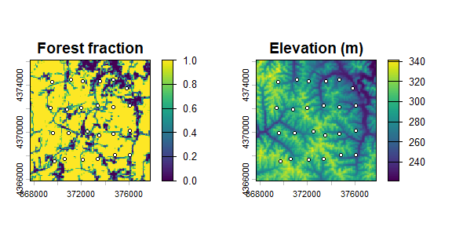
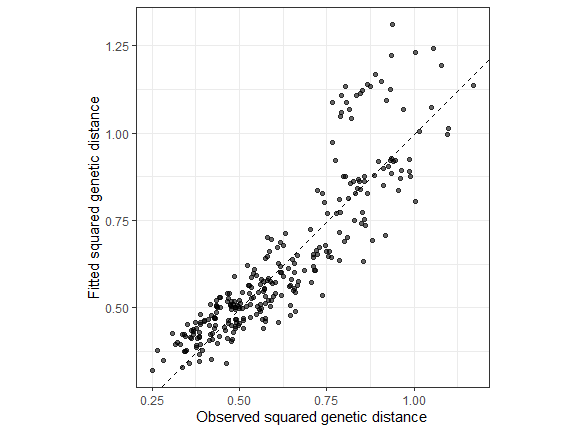
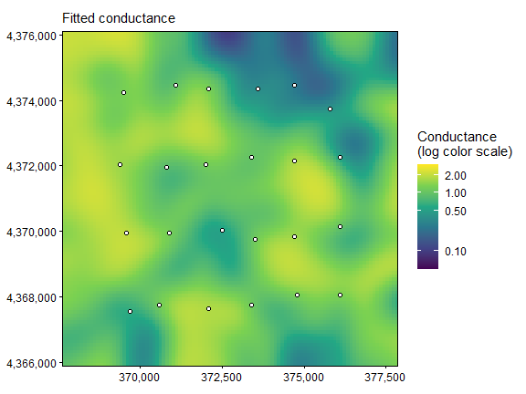
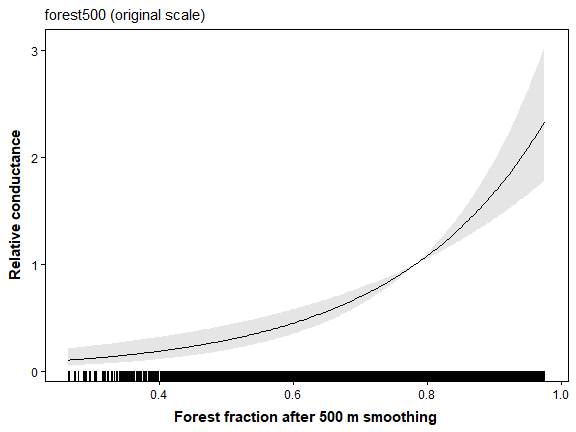
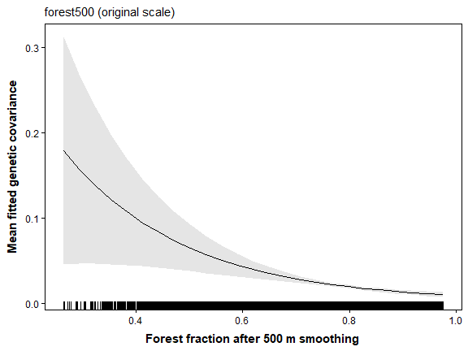
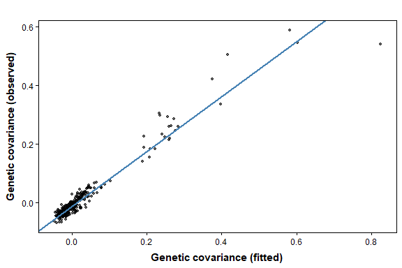
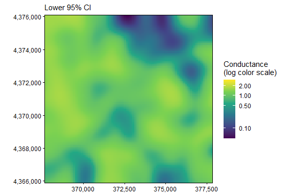
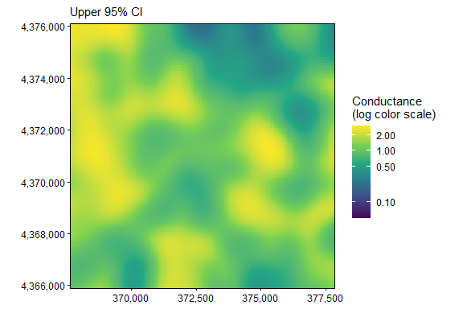

The displayed results and figures in this guide were computed from the
executable R Markdown source shipped with the package. Routine package
checks use these precomputed results to keep the CRAN check time modest.
To rerun every code chunk, copy `system.file("vignette-source", "getting-started.Rmd", package = "terradish")` to a writable directory and render that copy with `rmarkdown::render()`.

---


**Goal.** Follow one complete analysis from matched genotypes to a forest conductance map, using SNPs first and then microsatellites.

The [data-generation guide](data-generation.html) explains the landscapes,
SLiM histories, sampling, and matched markers used in these examples. Open it
in R with `vignette("data-generation", package = "terradish")`.

## What will you learn?

`terradish` fits associations between landscape covariates and genetic
differences among sampled populations or individuals. Under **isolation by
resistance (IBR)**, genetic patterns follow a graph of connected raster
cells, where higher cell conductance strengthens connections between
neighbors. The graph yields resistance distances and covariance among
sampling locations, and a measurement model links those quantities to the
observed genetic summary. Conductance is a fitted model quantity, so
claims about movement, habitat suitability, or causal effects need
evidence beyond the fitted surface.

Starting from raw simulated genotypes, this guide works through four steps:

1. Align the raster grid, sampling locations, and genotype rows.
2. Choose and construct the genetic response.
3. Specify a landscape conductance function and a measurement likelihood.
4. Fit, interpret, and check the model.

## Choose your next question

After this guide, pick the question that matches yours. Each guide reloads
the bundled data, so it runs in a fresh R session without SLiM or a
landscape download.

| Your question | Guide | Response used |
|---|---|---|
| How broad is the relevant forest neighborhood? | [`vignette("gaussian-scale-optimization", package = "terradish")`](gaussian-scale-optimization.html) | Pond SNP covariance |
| Do slope and elevation add useful information? | [`vignette("model-comparison", package = "terradish")`](model-comparison.html) | Same pond SNP covariance |
| Does a curved association predict better? | [`vignette("spline-conductance", package = "terradish")`](spline-conductance.html) | Same pond SNP covariance |
| Do differences between pond environments matter? | [`vignette("ibe-ibr-workflow", package = "terradish")`](ibe-ibr-workflow.html) | Pond SNP negative control, then a labeled covariance example |
| How do I interpret land-cover classes? | [`vignette("categorical-conductance", package = "terradish")`](categorical-conductance.html) | Labeled covariance example on the same landscape |
| How do individual genotypes reveal nonlinear resistance? | [`vignette("individual-salamanders", package = "terradish")`](individual-salamanders.html) | Terrestrial SNP IBR with matched microsatellite comparison |
| Which genetic response and information assumption should I use? | [`vignette("wishart-covariance", package = "terradish")`](wishart-covariance.html) | Matched pond SNPs and microsatellites |
| I have a pairwise genetic distance matrix ($F_{ST}$, $D_{PS}$) | [`vignette("mlpe-pairwise-distance", package = "terradish")`](mlpe-pairwise-distance.html) | Pairwise distance with MLPE |

Displayed results are precomputed to keep package builds fast.

**Starting from a pairwise distance matrix?** Fit pairwise $F_{ST}$,
$D_{PS}$, or individual genetic distances with `measurement_model = mlpe`
(maximum likelihood population effects), which accounts for pairs that
share a site. The conductance formula, graph, and coefficient
interpretation match this guide, and only the measurement model and its
nuisance parameters change (see `?mlpe`).
[`vignette("mlpe-pairwise-distance", package = "terradish")`](mlpe-pairwise-distance.html)
works through that case.

## Meet the forest-pond example

The example, motivated by a forest pond-breeding salamander, places 24
**hypothetical** ponds in native forest on public USGS elevation and 2023
land cover from southeastern Ohio. Each pond is one **deme**, or local
breeding population. Routes between ponds cross different amounts of
forest, so the question is whether forest along those routes helps explain
genetic similarity among ponds.

Pond exchange was simulated from a forest conductance graph with a
**500 m Gaussian context**, so forest affects exchange by construction,
although the settings are not calibrated to a real salamander population.
Each pond retains 20 animals screened to exclude known immediate
relatives, and all 480 carry both 2,500 SNPs and 24 microsatellite loci from the same
simulated ancestry.
[`vignette("data-generation", package = "terradish")`](data-generation.html)
gives the full design.

## Load and inspect the data


``` r
library(terradish)
library(terra)
data(ohio_ponds)

# Packed rasters store their values without a live external pointer.
raw <- terra::unwrap(ohio_ponds$covariates)
forest500 <- terra::unwrap(ohio_ponds$forest500)
ponds <- ohio_ponds$ponds
samples <- ohio_ponds$samples

data.frame(quantity = c("Ponds", "Raw captures", "Retained animals", "SNPs",
                        "Microsatellite loci"),
           number = c(nrow(ponds), nrow(ohio_ponds$raw_samples), nrow(samples),
                      ncol(ohio_ponds$snp), ncol(ohio_ponds$microsat) / 2))
#>              quantity number
#> 1               Ponds     24
#> 2        Raw captures    780
#> 3    Retained animals    480
#> 4                SNPs   2500
#> 5 Microsatellite loci     24
terra::res(raw)
#> [1] 100 100
table(samples$pond)
#>
#> P01 P02 P03 P04 P05 P06 P07 P08 P09 P10 P11 P12 P13 P14 P15 P16 P17 P18 P19 P20
#>  20  20  20  20  20  20  20  20  20  20  20  20  20  20  20  20  20  20  20  20
#> P21 P22 P23 P24
#>  20  20  20  20
```

**How to read the output.** The genetic rows are animals, but this guide
models ponds, each with 20 diploids (40 sampled allele copies). Cells are
100 m on a side, and the projected map (NAD83 / UTM zone 17N, EPSG:26917)
keeps distances in meters, which matters when you interpret a smoothing
distance. `?ohio_ponds` documents every field, including raw captures and
pedigree metadata.


``` r
local({
  old <- par(mfrow = c(1, 2), mar = c(3, 3, 2, 3))
  on.exit(par(old))
  terra::plot(raw[["forest"]], main = "Forest fraction")
  points(ponds$x, ponds$y, pch = 21, bg = "white", cex = 0.7)
  terra::plot(raw[["elevation"]], main = "Elevation (m)")
  points(ponds$x, ponds$y, pch = 21, bg = "white", cex = 0.7)
})
```



**How to read the map.** Every pond is forested, yet travel between ponds
is not equivalent, because the graph includes the intervening matrix and
alternate routes. Removing matrix cells would impose barriers absent from
the generating landscape.
Elevation is kept for later comparisons but has no direct generating
effect in this pond history.

## Turn SNP dosage into a pond covariance

A SNP dosage is the number of copies of a chosen allele in a diploid
animal (0, 1, or 2), not a genetic distance. Check the animal order, then
sum dosage within ponds.


``` r
G <- ohio_ponds$snp
stopifnot(identical(rownames(G), samples$individual))
groups <- factor(samples$pond, levels = ponds$pond)

# Y has ponds in rows and SNP loci in columns; N counts sampled haploids.
Y <- rowsum(G, groups, reorder = FALSE)
Y <- Y[ponds$pond, , drop = FALSE]  # declare pond order, regardless of capture order
N <- 2 * as.numeric(table(groups))
stopifnot(identical(rownames(Y), ponds$pond), all(N == N[1]))

# Equal sample sizes allow this common scale conversion to allele frequencies.
S <- cov_from_biallelic(Y, N) / N[1]
round(S[1:4, 1:4], 3)
#>        P01   P02   P03    P04
#> P01  0.336 0.053 0.025 -0.015
#> P02  0.053 0.260 0.067  0.031
#> P03  0.025 0.067 0.156  0.031
#> P04 -0.015 0.031 0.031  0.293
c(maximum_absolute_row_sum = max(abs(rowSums(S))),
  minimum_eigenvalue = min(eigen(S, symmetric = TRUE, only.values = TRUE)$values))
#> maximum_absolute_row_sum       minimum_eigenvalue
#>             1.845746e-15            -6.015204e-17
```

**How to read the output.** `S` is a 24 by 24 pond covariance. A positive
entry means two ponds depart from the pooled allele frequencies in the
same direction, and a negative entry means opposite directions. Row sums
are zero up to rounding because the covariance is centered. The smallest
eigenvalue is zero up to rounding rather than negative, so `S` is a valid
covariance matrix.

<details>
<summary>Optional: covariance formula and allele-frequency scaling</summary>

With equal sample sizes, the response is the average cross-product of
standardized pond allele frequencies:

$$
z_{k\ell} = \frac{\hat p_{k\ell}-\bar p_\ell}
 {\sqrt{\bar p_\ell(1-\bar p_\ell)}},
\qquad S = \frac{ZZ^\mathsf{T}}{P}.
$$

Here $k$ indexes ponds, $\ell$ indexes loci, and $P$ is the number of
retained loci. `cov_from_biallelic()` standardizes allele **counts**, and
dividing by the common `N[1]` gives the frequency scale above. With
unequal sample sizes, inspect the constructor's centering and
sampling-variance behavior instead of using this shortcut.

The standardization gives rare alleles more weight. The bundled panel
keeps loci with pooled minor allele frequency of at least 0.05, spread
along a linked 50 Mb chromosome.

</details>


``` r
# The covariance also defines a coherent squared-distance representation.
D <- dist_from_cov(S)
check_distance_response(D)
#> $admissible
#> [1] TRUE
#>
#> $min_eigenvalue
#> [1] -1.162121e-16
#>
#> $relative_min_eigenvalue
#> [1] -1.429493e-16
#>
#> $n_negative
#> [1] 0
#>
#> $tolerance
#> [1] 1e-07
#>
#> $eigenvalue_threshold
#> [1] 8.1296e-08
#>
#> $max_eigenvalue
#> [1] 0.81296
#>
#> $n_sites
#> [1] 24
round(D[1:4, 1:4], 3)
#>        P01   P02   P03   P04
#> [1,] 0.000 0.490 0.442 0.658
#> [2,] 0.490 0.000 0.281 0.490
#> [3,] 0.442 0.281 0.000 0.386
#> [4,] 0.658 0.490 0.386 0.000
```

**How to read the output.** `D` holds squared genetic distances,
$D_{ij}=S_{ii}+S_{jj}-2S_{ij}$, with a zero diagonal. It measures
differences in standardized allele frequencies, not $F_{ST}$ or meters.
`check_distance_response()` reports `admissible = TRUE` because `D` comes
from a valid covariance, so `generalized_wishart` could fit it. Distances
computed other ways, such as $F_{ST}$, often fail this check, so fit those
with `mlpe`.

The objects follow the sampling hierarchy:

| Object | Rows or spatial unit | Meaning |
|---|---|---|
| `G` | 480 animals | Alternate-allele dosage at each SNP |
| `Y` | 24 ponds | Allele counts summed within each deme |
| `S` | 24 by 24 ponds | Genetic covariance fitted by the measurement model |
| `surface` | Connected landscape cells, with 24 focal ponds | Routes through the landscape |
| `fit_forest` | One fitted model | Conductance association and response parameters |

Keep these units separate. More markers improve genetic measurement, while
more ponds change the spatial sampling design.

## Build the conductance graph

Start with the fixed `forest500` context that generated exchange, so the
first model has a single landscape coefficient. The Gaussian-scale guide
estimates that scale from the raw forest layer.


``` r
fixed <- c(raw, forest500)

# Standardize continuous layers over the full graph domain, not only pond cells.
scaled <- scale_covariates(fixed)
surface <- conductance_surface(scaled, ponds[c("x", "y")],
  directions = 8, saveStack = TRUE) # retain scaling information for plot axes
```

Eight directions connect each cell to its cardinal and diagonal
neighbors. Keep the same grid, edge rule, and domain for every model you
compare, and in a new study check that results hold under reasonable
changes in domain margins and raster resolution.

The fixed-context conductance is

$$C_i = \exp(\theta_{\mathrm{forest}} x_{i,500}),$$

where $x_{i,500}$ is the standardized, smoothed forest fraction. The
coefficient therefore describes one standard deviation (SD) of forest
context over this landscape, which is
0.132 in
forest fraction. There is no conductance intercept, because multiplying
every cell's conductance by the same constant does not change the fit.

## Fit forest and uniform-conductance models

Fit both models to the same response, graph, and likelihood. The Wishart
likelihood also needs `nu`, the amount of independent information you
assume `S` contains. You must supply it, and it is not the SNP count,
because linked SNPs share history. We use `nu = 40` as a working value (it
matches `N` only by coincidence). Hold it fixed across compared models and
report how results change over a plausible range.


``` r
control <- NewtonRaphsonControl(maxit = 200, ctol = 1e-8, ftol = 1e-8)
fit_uniform <- terradish(S ~ 1, surface,
  measurement_model = wishart_covariance, nu = 40,
  optimizer = "bfgs", control = control)
fit_forest <- terradish(S ~ forest500, surface,
  measurement_model = wishart_covariance, nu = 40,
  optimizer = "bfgs", control = control)

summary(fit_forest)
#> Conductance surface with 10404 vertices (24 focal) estimated by maximum likelihood
#> Call:   terradish(formula = S ~ forest500, data = surface, measurement_model = wishart_covariance,
#>     nu = 40, optimizer = "bfgs", control = control)
#>
#> Loglikelihood: 141.3124 (3 degrees freedom)
#> AIC: -276.6249
#>
#> Number of function calls: 13
#> Number of optimization steps: 6
#> Convergence: converged | projected gradient: 1.7e-12
#> Norm of gradient at MLE: 1.703684e-12
#>
#> Nuisance parameters (conditional on fitted conductance surface; measurement-model scale):
#>        Estimate  Std. Error  Lower 95%  Upper 95%
#> tau     1.5090    0.1928      1.1311     1.8870
#> sigma  -3.4186    0.7604     -4.9090    -1.9281
#>
#> Coefficients:
#>           Estimate Std. Error z value Pr(>|z|)
#> forest500  0.58003    0.09377   6.185 6.19e-10 ***
#> ---
#> Signif. codes:  0 '***' 0.001 '**' 0.01 '*' 0.05 '.' 0.1 ' ' 1
```

**How to read the summary.** First check the `Convergence:` line. In the
`Coefficients` table, `forest500` is on the log-conductance scale, and its
positive estimate means more forest context goes with higher conductance.
The uniform model (conductance one everywhere) is the graph version of
isolation by distance (IBD), where genetic differences grow with
separation but no cell is easier to cross than another.

The `Nuisance parameters` block holds measurement-model parameters the fit
needs but that are not of direct interest. The fitted covariance is
$\Sigma=\tau E(\theta)+\exp(\sigma_{\mathrm{nugget}})I$, where $E$ is the
graph covariance and $I$ is the identity matrix. Because the likelihood
compares ponds with one another, adding a constant to every entry of `S`
does not change the fit.

| Parameter | Where it appears | What it measures |
|---|---|---|
| `forest500` (theta) | `coef(fit_forest)` | Change in log conductance per one SD of forest context |
| `tau` | `summary(fit_forest)$phi` | Weight of the graph covariance in the fitted covariance |
| `sigma` | `summary(fit_forest)$phi`, log scale | Log of the extra variance added to each pond (the nugget); not a smoothing distance |
| `nu` | Supplied by you | Assumed information in `S`, held fixed across compared models |


``` r
theta_forest <- coef(fit_forest)[["forest500"]]
c(conductance_ratio_per_SD = exp(theta_forest),
  percent_change_per_SD = 100 * (exp(theta_forest) - 1),
  nugget_variance = exp(summary(fit_forest)$phi[["sigma"]]))
#> conductance_ratio_per_SD    percent_change_per_SD          nugget_variance
#>               1.78608717              78.60871721               0.03275952
exp(confint(fit_forest))  # 95% interval for the conductance ratio
#>              2.5 %   97.5 %
#> forest500 1.486221 2.146456
```

**How to read these values.** Exponentiating the coefficient gives a
conductance ratio. Each one-SD increase in smoothed forest
(0.13 in
forest fraction) multiplies conductance by about
1.79, a 79%
increase, with a 95% interval of
1.49 to 2.15.
The nugget variance is in the units of `S`. It absorbs sampling variation
and model mismatch and does not measure drift or population size.


``` r
# Lower assumed information widens uncertainty without changing the coefficients.
less_information <- terradish_rescale_nu(fit_forest, nu = 20)
rbind(nu40 = sqrt(diag(vcov(fit_forest))),
      nu20 = sqrt(diag(vcov(less_information))))
#>       forest500
#> nu40 0.09377258
#> nu20 0.13261445
```

**How to read the output.** Halving `nu` multiplies each standard error by
$\sqrt{2}$ but leaves the estimate unchanged. If the interval still
excludes zero at the smallest plausible `nu`, the conclusion does not
hinge on that assumption. The check does not estimate the true
information content.

## Check convergence, comparison, and adequacy


``` r
aic_table(list(fit_uniform, fit_forest), mod_names = c("uniform", "forest500"))
#>       model K       AIC Delta_AIC AIC_wt Cum.wt   loglik converged boundary
#> 2 forest500 3 -276.6249    0.0000      1      1 141.3124      TRUE    FALSE
#> 1   uniform 2 -203.5238   73.1011      0      1 103.7619      TRUE    FALSE
```

**How to read the output.** Check `converged` first. It is `TRUE` only
when both the conductance optimizer (`fit$convergence$code`) and the
final nuisance optimization (`fit$fit$subproblem$convergence`) returned
code 0, and `boundary` flags an estimate stuck at a limit. Lower AIC is
better, `Delta_AIC` is each model's distance from the best, and `AIC_wt`
is its relative support within this set. Models within 2 AIC units of the
best have comparable support. The forest model is
73.1 AIC units
better than uniform conductance. AIC depends on `nu`, and fits to
different marker panels or likelihood families cannot share one table.


``` r
library(ggplot2)
# Include the measurement nugget by converting fitted response covariance.
predicted_D <- dist_from_cov(fitted(fit_forest))
pairs <- lower.tri(D)
diagnostic <- data.frame(observed = D[pairs], fitted = predicted_D[pairs])
ggplot(diagnostic, aes(observed, fitted)) +
  geom_point(alpha = 0.6, size = 1.5) +
  geom_abline(slope = 1, intercept = 0, linetype = 2) +
  coord_equal() + theme_bw() +
  labs(x = "Observed squared genetic distance", y = "Fitted squared genetic distance")
```



**How to read the plot.** Points near the dashed line are pond pairs the
model predicts well, and the spread shows variation it does not capture.
If a group of points sits off the line together, color them by pond to see
whether one pond drives the misfit. Pairs share ponds, so the points are
not independent, and a regression through them is not a new test.


``` r
C <- conductance(surface, fit_forest)
maps <- plot(fit_forest, type = "surface", data = surface)
# Use the same limits here and in the three uncertainty panels below.
map_limits <- range(terra::values(C), na.rm = TRUE)
map_colors <- scale_fill_viridis_c(
  trans = "log10", limits = map_limits,
  breaks = c(0.01, 0.1, 0.5, 1, 2, 5, 10, 20),
  name = "Conductance\n(log color scale)"
)
maps[[1]] + map_colors +
  geom_point(data = ponds, aes(x = x, y = y), inherit.aes = FALSE,
             shape = 21, fill = "white", size = 1.5)
```



**How to read the map.** Yellow cells have high fitted conductance and
dark purple cells low conductance, across the whole landscape, not only
near ponds. On the logarithmic scale, equal color steps are equal ratios,
so 0.5 to 1 is the same step as 1 to 2. Values are relative to an average
cell, not probabilities of movement or survival. Shared limits let you
compare this map directly with the interval maps below.

## Follow forest from conductance to the genetic response

The conductance curve shows the forest relationship fitted to raster
cells. The genetic-response curve passes that relationship through the
graph and measurement model.


``` r
plot(fit_forest, type = "marginal", data = surface,
     marginal_covariates = "forest500") +
  labs(x = "Forest fraction after 500 m smoothing", y = "Relative conductance")
```



**How to read the curve.** Conductance rises with forest and equals 1 at
the landscape-average forest value, so the curve shows conductance
relative to an average cell. The horizontal axis is back-transformed to
forest fraction because `saveStack = TRUE` kept the scaling information.
The rug marks landscape forest values, and the band reflects coefficient
uncertainty under `nu = 40`.


``` r
# Each point requires a graph solve; 25 points keep this demonstration manageable.
plot(fit_forest, type = "marginal_response", data = surface,
     marginal_covariates = "forest500", n = 25) +
  labs(x = "Forest fraction after 500 m smoothing",
       y = "Mean fitted genetic covariance")
```



**How to read the genetic-response curve.** At each forest value,
`type = "marginal_response"` sets forest to that value in every cell,
recalculates the fitted covariance among ponds, and averages it. More
conductance shrinks the graph's contribution to genetic covariance, so the
curve falls as forest rises. With forest as the only predictor, one forest
value makes conductance uniform, so this curve is the conductance curve
inverted and rescaled. It is more informative in models where other
predictors still vary across the landscape. The band is an approximate
interval for the average, not for any one pond pair. `?plot.terradish`
describes each plot type.

The package also draws the observed-versus-fitted check and interval maps:


``` r
plot(fit_forest, type = "fit")
```



**How to read the plot.** This covariance-scale version of the distance
plot separates pond variances (the diagonal of `S`) from between-pond
covariances, so judge agreement within each cluster. Fitted values are on
the horizontal axis, and the blue line is a least-squares fit of observed
on fitted values, not the 1:1 line.


``` r
for (p in maps[-1]) print(p + map_colors)
```





**How to read the maps.** The bounds share the estimate's spatial pattern
because they come from the same forest coefficient. Conductance is least
certain where the bounds differ most, in cells whose forest context lies
farthest from the landscape average.

## Construct the matched microsatellite response

Microsatellite repeat counts are allele **labels**, not dosages. The
constructor turns the two allele columns per locus into standardized
allele-indicator features and a grouped covariance with a coherent Gower
diagonal.


``` r
stopifnot(identical(rownames(ohio_ponds$microsat), samples$individual))
S_ms <- cov_from_genetic_data(ohio_ponds$microsat, groups = groups,
  input = "allele_calls", loci = ohio_ponds$microsat_loci,
  diagonal = "gower", normalize = "features")
fit_ms <- terradish(S_ms ~ forest500, surface,
  measurement_model = wishart_covariance, nu = 40,
  optimizer = "bfgs", control = control)

data.frame(marker = c("2500 SNPs", "24 microsatellite loci"),
  forest_coefficient = c(coef(fit_forest)[["forest500"]],
                         coef(fit_ms)[["forest500"]]),
  conductance_ratio = exp(c(coef(fit_forest)[["forest500"]],
                            coef(fit_ms)[["forest500"]])))
#>                   marker forest_coefficient conductance_ratio
#> 1              2500 SNPs          0.5800273          1.786087
#> 2 24 microsatellite loci          0.4887609          1.630295
```

**How to read the output.** Both panels come from the same animals and
history, and both estimate a positive forest effect. Compare the
coefficients, but do not rank the fits by AIC or log-likelihood, because
different responses give incomparable likelihoods. Nor are the two panels
independent replicates. `diagonal = "gower"` puts each pond's variance on
the scale of the between-pond covariances, as the Wishart likelihood
requires, whereas the `"within"` diagonal is on a different scale and is
unsuitable here.

## Quick reference: a complete fixed-context SNP workflow


``` r
library(terradish)
library(terra)
library(ggplot2)
data(ohio_ponds)

# 1. Align individuals and ponds, then summarize equal-size allele counts.
g <- factor(ohio_ponds$samples$pond, levels = ohio_ponds$ponds$pond)
Y <- rowsum(ohio_ponds$snp, g, reorder = FALSE)
Y <- Y[ohio_ponds$ponds$pond, , drop = FALSE]
N <- 2 * as.numeric(table(g))
stopifnot(all(N == N[1]))
S <- cov_from_biallelic(Y, N) / N[1]

# 2. Retain the full projected landscape, including the matrix between ponds.
x <- c(unwrap(ohio_ponds$covariates), unwrap(ohio_ponds$forest500))
graph <- conductance_surface(scale_covariates(x), ohio_ponds$ponds[c("x", "y")],
  directions = 8, saveStack = TRUE)

# 3. Fit uniform and forest models; nu is an assumption, not the SNP count.
control <- NewtonRaphsonControl(maxit = 200, ctol = 1e-8, ftol = 1e-8)
fit0 <- terradish(S ~ 1, graph, measurement_model = wishart_covariance,
  nu = 40, optimizer = "bfgs", control = control)
fit <- terradish(S ~ forest500, graph, measurement_model = wishart_covariance,
  nu = 40, optimizer = "bfgs", control = control)

# 4. Check convergence and compare; then read the coefficient as a ratio.
aic_table(list(fit0, fit), mod_names = c("uniform", "forest500"))  # converged, Delta_AIC
summary(fit)           # log-conductance coefficient and nuisance parameters
exp(coef(fit))         # conductance ratio per SD of forest context
exp(confint(fit))      # 95% interval for that ratio
plot(fit, type = "marginal", data = graph)  # conductance across forest values
maps <- plot(fit, type = "surface", data = graph)
C <- conductance(graph, fit)
map_limits <- range(terra::values(C), na.rm = TRUE)

# Keep all cells and share limits across the estimate and both bounds.
for (p in maps) {
  print(p + scale_fill_viridis_c(
    trans = "log10", limits = map_limits,
    breaks = c(0.01, 0.1, 0.5, 1, 2, 5, 10, 20),
    name = "Conductance\n(log color scale)"
  ))
}
```

## Summary of key functions

| Function | Purpose |
|---|---|
| `cov_from_biallelic()` | Construct covariance from SNP allele counts |
| `cov_from_genetic_data()` | Construct covariance from genetic feature or allele-call inputs |
| `dist_from_cov()` | Obtain the corresponding squared genetic distances |
| `check_distance_response()` | Check distance geometry for a Wishart response |
| `scale_covariates()` | Standardize continuous layers for a fixed-context model |
| `conductance_surface()` | Build the graph and align its focal sites |
| `terradish()` | Fit conductance and measurement parameters |
| `terradish_rescale_nu()` | Examine sensitivity to assumed Wishart information |
| `aic_table()` | Compare compatible fits within a candidate set |
| `conductance()` | Map fitted relative conductance and pointwise intervals |
| `plot.terradish()` | Plot fitted covariance, maps, conductance curves, and genetic-response summaries |

## See also

- [`vignette("gaussian-scale-optimization", package = "terradish")`](gaussian-scale-optimization.html):
  estimate forest context and inspect its profile and prediction.
- [`vignette("model-comparison", package = "terradish")`](model-comparison.html):
  compare candidate covariates and held-out performance.
- [`vignette("spline-conductance", package = "terradish")`](spline-conductance.html):
  distinguish nonlinear response shape from spatial context.
- [`vignette("ibe-ibr-workflow", package = "terradish")`](ibe-ibr-workflow.html):
  distinguish environmental differences from resistance.
- [`vignette("categorical-conductance", package = "terradish")`](categorical-conductance.html):
  class contrasts on a separate specified covariance example.
- [`vignette("wishart-covariance", package = "terradish")`](wishart-covariance.html):
  choose between a covariance response and a pairwise distance with MLPE.
- [`vignette("mlpe-pairwise-distance", package = "terradish")`](mlpe-pairwise-distance.html):
  fit a pairwise genetic distance such as $F_{ST}$ with MLPE and read its summary.
- [`vignette("individual-salamanders", package = "terradish")`](individual-salamanders.html):
  individual genotypes and a nonlinear (hump-shaped) resistance response.
- [`vignette("large-landscapes", package = "terradish")`](large-landscapes.html):
  solvers, cropping, and warm starts for large rasters.
- [`vignette("simulation-design", package = "terradish")`](simulation-design.html):
  simulate responses to plan sampling and check power.
- [`vignette("data-generation", package = "terradish")`](data-generation.html):
  how the example landscapes, histories, and markers were produced.
- `?ohio_ponds`: data fields, assumptions, and installed provenance.
