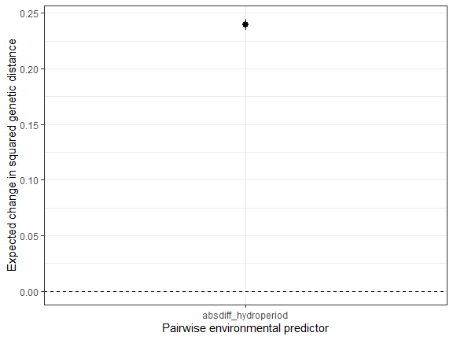
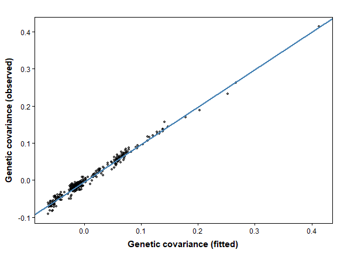

The displayed results and figures in this guide were computed from the
executable R Markdown source shipped with the package. Routine package
checks use these precomputed results to keep the CRAN check time modest.
To rerun every code chunk, copy `system.file("vignette-source", "ibe-ibr-workflow.Rmd", package = "terradish")` to a writable directory and render that copy with `rmarkdown::render()`.

---


**Goal.** Isolation by resistance (IBR) predicts that genetic differences
grow with the landscape resistance between two ponds. Isolation by
environment (IBE) predicts that they grow with the environmental
difference between the ponds themselves. This guide shows you how to fit
both in one model, read each coefficient, and test whether the
environmental term improves prediction. The basic MLPE (maximum likelihood
population effects) workflow for pairwise genetic distances is in
[`vignette("mlpe-pairwise-distance", package = "terradish")`](mlpe-pairwise-distance.html),
and this guide extends it with environmental differences.

## Three environmental hypotheses that should stay distinct

Two forest ponds with similar hydroperiod (days a pond holds water) but
open land between them pose an IBR question. Two ponds joined by similar
forest routes but with very different hydroperiods pose an endpoint
environment question. Resistance and endpoint differences can be associated
with the same genetic pattern, but they enter models differently.
[`vignette("getting-started", package = "terradish")`](getting-started.html)
introduces the Ohio pond genotypes and resistance graph used here.

This guide distinguishes:

1. **MLPE paired-difference association:** environmental differences enter
   the conditional mean of pairwise genetic distances.
2. **Wishart environmental covariance:** a positive semidefinite site
   kernel enters the covariance model with a nonnegative weight.
3. **Environment-dependent exchange in a biological simulation:** an
   environmental filter changes reproduction or successful dispersal, and
   therefore ancestry. It need not produce the additive covariance in
   item 2.

The bundled SLiM pond history gives forest resistance an active role and
hydroperiod **no** generating effect, so it serves as a negative control.
A separate response with a known positive environmental component then
shows a real IBE signal.

## Prepare the graph, genotypes, and endpoint differences


``` r
library(terradish)
library(terra)
data(ohio_ponds)
ponds <- ohio_ponds$ponds
g <- factor(ohio_ponds$samples$pond, levels = ponds$pond)
N <- 2 * as.numeric(table(g))
S_snp <- cov_from_biallelic(rowsum(ohio_ponds$snp, g, reorder = FALSE)[ohio_ponds$ponds$pond, , drop = FALSE], N) / N[1]
D_snp <- dist_from_cov(S_snp)

# Here forest500 is an unstandardized fraction; its coefficient is per unit fraction.
forest500 <- unwrap(ohio_ponds$forest500)
surface <- conductance_surface(forest500, ponds[c("x", "y")], directions = 8)

# Hypothetical hydroperiod is measured in days. Scale sites before forming differences.
environment <- data.frame(hydroperiod = ponds$hydroperiod)
pair_covariates <- pairwise_endpoint_covariates(environment,
  transform = "absdiff", scale = TRUE)
head(pair_covariates)
#>      absdiff_hydroperiod
#> [1,]          0.12317960
#> [2,]          0.07687923
#> [3,]          1.27291078
#> [4,]          1.14482820
#> [5,]          1.29603418
#> [6,]          1.16267608
```

**How to read the output.** Each row is a pond pair, taken from the
lower triangle column by column. The column is the absolute difference in
standardized hydroperiod, so a value of one means the ponds differ by one
full-site SD, not one day. Attributes store the site values and transform
for spatial validation. Site order must match the genetic matrix and the
graph's focal ponds.

## Define the two measurement constructions


``` r
g_mlpe <- mlpe_covariates(pair_covariates)
g_cov <- wishart_covariates(pair_covariates, model = "wishart_covariance")

Delta <- matrix(0, nrow(ponds), nrow(ponds))
Delta[lower.tri(Delta)] <- pair_covariates[, 1]
Delta <- Delta + t(Delta)
H <- diag(nrow(ponds)) - 1 / nrow(ponds)
K <- -0.5 * H %*% Delta %*% H
c(minimum_kernel_eigenvalue = min(eigen(K, symmetric = TRUE, only.values = TRUE)$values),
  maximum_kernel_row_sum = max(abs(rowSums(K))))
#> minimum_kernel_eigenvalue    maximum_kernel_row_sum
#>              1.807218e-16              2.706169e-15
```

**How to read the kernel check.** `K` is a centered site covariance
kernel built from environmental **differences**, not raster smoothing.
Tiny negative eigenvalues from rounding are harmless. Substantive ones
make the kernel invalid, which `wishart_covariates()` checks before
fitting.

The two fitted models have different likelihoods:

$$\mathrm{E}[D_{ij}]=\alpha+\beta R_{ij}(\theta)+\gamma\Delta_{ij}
\quad\text{(MLPE mean)},$$

$$\Sigma=\tau E(\theta)+\lambda K+vI,\qquad
K=-\tfrac12 H\Delta H,\quad v=\exp(\sigma_{\mathrm{nugget}})
\quad\text{(Wishart covariance)}.$$

MLPE is a Gaussian pairwise-distance model with shared-site dependence
and an unconstrained environmental slope $\gamma$. Wishart models
covariance among site contrasts, needs a coherent genetic response and
assumed effective information, and constrains $\lambda\geq0$. Its implied
off-diagonal squared-distance mean is

$$\mathrm{E}[D_{ij}]=\tau R_{ij}(\theta)+\lambda\Delta_{ij}+2v.$$

Both distance means can carry an additive environmental term, but their
constraints, dependence models, and likelihoods differ. Wishart cannot
represent a negative MLPE slope.

| Quantity | Where it appears | What it measures |
|---|---|---|
| Forest coefficient (theta) | `coef(fit)` | Change in log conductance per unit raw forest fraction in this guide |
| MLPE `alpha` | `summary(fit)$phi` | Expected genetic distance at zero resistance distance |
| MLPE `beta` | `summary(fit)$phi` | IBR slope: increase in genetic distance per unit resistance distance |
| MLPE `absdiff_hydroperiod` (gamma) | `summary(fit)$phi` | Change in genetic distance per unit endpoint difference, holding resistance fixed |
| MLPE `tau` | `summary(fit)$phi`, log scale | Log residual precision; residual SD is `exp(-tau / 2)` |
| MLPE `rho` | `summary(fit)$phi`, logit scale | Shared-pond correlation is `plogis(rho) / 2`, between 0 and 0.5 |
| Wishart kernel weight (lambda) | `summary(fit)$phi` | Nonnegative environmental covariance component |
| Wishart `tau` | `summary(fit)$phi` | Weight of graph covariance; a different parameter despite the shared name |
| Wishart `sigma` | `summary(fit)$phi`, log scale | Log of the extra variance added to each pond |

<details>
<summary>Optional: absolute differences, squared differences, and similarity kernels</summary>

### This kernel is not a Gaussian similarity kernel

The default `absdiff` uses $\Delta_{ij}=|z_i-z_j|$, and `sqdiff` uses
$(z_i-z_j)^2$, whose centered kernel is a rank-one outer product. Neither
is the Gaussian similarity kernel $\exp[-(z_i-z_j)^2/(2h^2)]$, so do not
call an absolute-difference component a Gaussian IBE kernel. A Gaussian
kernel would need its own difference construction and an endpoint
bandwidth, distinct from the spatial smoothing scale of forest.

</details>

## Use the SLiM SNP response as a negative control


``` r
control <- NewtonRaphsonControl(maxit = 200, ctol = 1e-8, ftol = 1e-8)
fit_snp_cov <- terradish(S_snp ~ forest500, surface,
  measurement_model = wishart_covariance, nu = 40,
  optimizer = "bfgs", control = control)
fit_snp_cov_env <- terradish(S_snp ~ forest500, surface,
  measurement_model = g_cov, nu = 40, optimizer = "bfgs", control = control)
fit_snp_mlpe <- terradish(D_snp ~ forest500, surface,
  measurement_model = mlpe, optimizer = "bfgs", control = control)
fit_snp_mlpe_env <- terradish(D_snp ~ forest500, surface,
  measurement_model = g_mlpe, optimizer = "bfgs", control = control)
all_snp <- list(fit_snp_cov, fit_snp_cov_env, fit_snp_mlpe, fit_snp_mlpe_env)
stopifnot(all(vapply(all_snp, function(z) z$convergence$code == 0 &&
  z$fit$subproblem$convergence == 0, logical(1))))

# Separate tables: these are not a common likelihood scale across families.
aic_table(list(fit_snp_cov, fit_snp_cov_env), mod_names = c("IBR", "IBR + kernel"))
#>          model K       AIC Delta_AIC AIC_wt Cum.wt   loglik converged boundary
#> 1          IBR 3 -276.6249         0 0.7311 0.7311 141.3124      TRUE    FALSE
#> 2 IBR + kernel 4 -274.6249         2 0.2689 1.0000 141.3124      TRUE     TRUE
aic_table(list(fit_snp_mlpe, fit_snp_mlpe_env), mod_names = c("IBR", "IBR + difference"))
#>              model K       AIC Delta_AIC AIC_wt Cum.wt   loglik converged
#> 1              IBR 5 -1646.232    0.0000 0.6326 0.6326 828.1162      TRUE
#> 2 IBR + difference 6 -1645.146    1.0868 0.3674 1.0000 828.5728      TRUE
#>   boundary
#> 1    FALSE
#> 2    FALSE
```

**How to read these comparisons.** Compare models only within a table,
because the tables use different responses and likelihoods. In the
Wishart table the kernel weight sits at its lower bound of zero
(`boundary = TRUE`), so the log-likelihood is unchanged and the extra
parameter costs exactly 2 AIC units. Do not report a symmetric interval
around this boundary estimate. In the MLPE table the hydroperiod
difference raises the log-likelihood by only
0.46,
less than its penalty, so IBR alone ranks first. Both results match the
zero generating effect.


``` r
summary(fit_snp_mlpe_env)
#> Conductance surface with 10404 vertices (24 focal) estimated by maximum likelihood
#> Call:   terradish(formula = D_snp ~ forest500, data = surface, measurement_model = g_mlpe,
#>     optimizer = "bfgs", control = control)
#>
#> Loglikelihood: 828.5728 (6 degrees freedom)
#> AIC: -1645.146
#>
#> Number of function calls: 12
#> Number of optimization steps: 5
#> Convergence: converged | projected gradient: 4.08e-10
#> Norm of gradient at MLE: 4.084646e-10
#>
#> Nuisance parameters (conditional on fitted conductance surface; measurement-model scale):
#>                      Estimate   Std. Error  Lower 95%  Upper 95%
#> alpha                 0.084786   0.029774    0.026431   0.143141
#> beta                 35.934455   0.992163   33.989851  37.879059
#> absdiff_hydroperiod   0.001749   0.001828   -0.001835   0.005333
#> tau                   4.760509   0.271667    4.228051   5.292966
#> rho                   2.611649   0.305231    2.013408   3.209891
#>
#> Resistance-distance equivalent of one unit of environmental difference:
#>            covariate        ratio           SE         lower        upper
#>  absdiff_hydroperiod 4.866727e-05 5.177387e-05 -5.280765e-05 0.0001501422
#>             family
#>  gaussian_distance
#> Coefficients:
#>           Estimate Std. Error z value Pr(>|z|)
#> forest500   4.1047     0.2466   16.64   <2e-16 ***
#> ---
#> Signif. codes:  0 '***' 0.001 '**' 0.01 '*' 0.05 '.' 0.1 ' ' 1
phi_mlpe <- summary(fit_snp_mlpe_env)$phi
c(residual_sd = exp(-phi_mlpe[["tau"]] / 2),
  shared_pond_correlation = plogis(phi_mlpe[["rho"]]) / 2)
#>             residual_sd shared_pond_correlation
#>              0.09252705              0.46580378
```

**How to read the MLPE summary.** The `Coefficients` table holds the
forest conductance estimate, read as in Getting Started. The
`Nuisance parameters` block holds the MLPE regression. `alpha`
(0.085) is the expected genetic distance at
zero resistance distance. `beta` (35.9)
is the IBR slope, the increase in genetic distance per unit resistance
distance. `absdiff_hydroperiod` (0.0017) is the
environmental slope, and its interval spans zero, as expected for this
negative control. `tau` is the log residual precision, so the residual
standard deviation is `exp(-tau / 2)`, about
0.093. `rho` is printed on the
logit scale, and `plogis(rho) / 2` converts it to the correlation
between two pairs that share a pond, here
0.47. A value near the 0.5 ceiling
means pond identity explains most of the residual variation, which is
why pairwise distances need MLPE rather than ordinary regression.

The `Resistance-distance equivalent` table, also available from
`terradish_ibe_ratio()`, divides the environmental slope by `beta`,
giving the resistance distance that changes genetic distance as much as
one unit of environmental difference. Its interval also spans zero here.

## A separate positive example: generate a covariance component

Use the same landscape and endpoint values with a **separate statistical
response** whose covariance contains graph weight 0.08, environmental
weight 0.10, and diagonal variance 0.01. The graph is normalized here
only to fix its units. The package does not normalize environmental
kernels after constructing them.


``` r
E <- terradish_distance(matrix(6, nrow = 1,
  dimnames = list(NULL, "forest500")), ~ forest500, surface,
  covariance = TRUE)$covariance[, , 1]
E <- E / mean(diag(H %*% E %*% H))
Sigma <- 0.08 * E + 0.10 * K + 0.01 * diag(nrow(ponds))
expected_D <- 0.08 * dist_from_cov(E) + 0.10 * Delta + 0.02
diag(expected_D) <- 0
stopifnot(max(abs(dist_from_cov(Sigma) - expected_D)) < 1e-10)

# A reproducible sample covariance of 400 independent Gaussian features.
# Restore the caller's random-number state after this local demonstration.
S_benchmark <- local({
  had_seed <- exists(".Random.seed", envir = .GlobalEnv, inherits = FALSE)
  if (had_seed) previous_seed <- get(".Random.seed", envir = .GlobalEnv)
  on.exit(if (had_seed) assign(".Random.seed", previous_seed, envir = .GlobalEnv)
          else rm(".Random.seed", envir = .GlobalEnv))
  set.seed(79301)
  S <- rWishart(1, df = 400, Sigma = Sigma)[, , 1] / 400
  H %*% S %*% H
})
D_benchmark <- dist_from_cov(S_benchmark)
```

The identity check confirms that the distance and covariance forms
describe the same generated features. Those features lack the SLiM
panel's linkage, allele ascertainment, demographic history, and mutation
process, so their 400 degrees of freedom cannot calibrate `nu` for the
SNP analysis.


``` r
benchmark_attempts <- list()
fit_benchmark <- function(response, measurement, nu, label) {
  candidates <- list()
  for (start in c(-0.5, 0, 0.5)) {
    fit <- tryCatch(terradish(response ~ forest500, surface,
      measurement_model = measurement, nu = nu, theta = c(forest500 = start),
      optimizer = "bfgs", control = control), error = identity)
    valid <- !inherits(fit, "error") && isTRUE(fit$convergence$code == 0) &&
      isTRUE(fit$fit$subproblem$convergence == 0)
    benchmark_attempts[[length(benchmark_attempts) + 1L]] <<- data.frame(
      family = label, start, valid,
      logLik = if (inherits(fit, "error")) NA_real_ else as.numeric(logLik(fit)))
    if (valid) candidates[[length(candidates) + 1L]] <- fit
  }
  if (!length(candidates)) stop("No converged benchmark fit for ", label)
  candidates[[which.max(vapply(candidates, function(z) as.numeric(logLik(z)), numeric(1)))]]
}
fit_cov <- fit_benchmark(S_benchmark, g_cov, 400, "Wishart")
fit_mlpe <- fit_benchmark(D_benchmark, g_mlpe, NULL, "MLPE")
do.call(rbind, benchmark_attempts)
#>    family start valid   logLik
#> 1 Wishart  -0.5  TRUE 6279.478
#> 2 Wishart   0.0  TRUE 6279.478
#> 3 Wishart   0.5  TRUE 6279.478
#> 4    MLPE  -0.5  TRUE 1018.029
#> 5    MLPE   0.0  TRUE 1018.029
#> 6    MLPE   0.5  TRUE 1018.029
stopifnot(fit_cov$convergence$code == 0, fit_cov$fit$subproblem$convergence == 0,
          fit_mlpe$convergence$code == 0, fit_mlpe$fit$subproblem$convergence == 0)
environmental_estimate <- function(fit) {
  phi <- fit$fit$phi
  unname(phi[grepl("hydroperiod", rownames(phi)), 1])
}
data.frame(construction = c("Wishart covariance weight", "MLPE paired-mean slope"),
  known_additive_distance_weight = 0.10,
  estimate = c(environmental_estimate(fit_cov), environmental_estimate(fit_mlpe)))
#>                construction known_additive_distance_weight  estimate
#> 1 Wishart covariance weight                            0.1 0.0984631
#> 2    MLPE paired-mean slope                            0.1 0.1000928
```

**How to read the output.** Each estimate is near the declared 0.10
component on its own model scale. The shared expected-distance identity
explains the similar numbers. It does not make the likelihoods
interchangeable or validate either family for arbitrary genetic
summaries, so do not pool their AICs or held-out log-likelihoods into
one ranking.

The attempts table keeps every starting value. Compare likelihoods only
when both convergence codes are zero. Agreement among converged starts
supports numerical consistency but does not prove a global optimum.
Judge each fit by its final convergence records, not by warnings, which
intermediate nuisance steps can raise even when a later retry converges.

## Plot the environmental contribution

An IBE coefficient belongs to the measurement model, not the raster
conductance formula. `mlpe_response_change()` turns it into a change in
genetic distance across a specified environmental contrast.


``` r
library(ggplot2)
change <- mlpe_response_change(fit_mlpe)
change
#>             covariate        low     high contrast  estimate  conf.low
#> 1 absdiff_hydroperiod 0.03976171 2.433682  2.39392 0.2396142 0.2347029
#>   conf.high conf.level
#> 1 0.2445255       0.95
ggplot(change, aes(covariate, estimate)) +
  geom_hline(yintercept = 0, linetype = 2) +
  geom_pointrange(aes(ymin = conf.low, ymax = conf.high)) +
  theme_bw() + labs(x = "Pairwise environmental predictor",
                    y = "Expected change in squared genetic distance")
```



**How to read the output.** `low` and `high` are the 10th and 90th
percentiles of the pairwise hydroperiod difference, in SD units.
`estimate` is the expected change in squared genetic distance across
that contrast, holding resistance fixed, about
0.24, with a 95% interval of
0.23 to 0.24.
It equals the environmental slope times the width of the contrast. A
positive value means ponds with more different hydroperiods are more
genetically different at the same landscape resistance.


``` r
plot(fit_cov, type = "fit")
```



**How to read the plot.** This checks the combined graph and
environmental covariance against the response. Pond variances (the
diagonal) cluster apart from the between-pond covariances, and the blue
line is a least-squares fit, not the 1:1 line. A forest
`type = "marginal"` plot would show IBR conductance, not the hydroperiod
effect, and `mlpe_response_change()` applies only to MLPE fits.

## Validate an environmental extension within one family


``` r
cv_cov <- terradish_cv_folds(surface,
  list(IBR = S_benchmark ~ forest500, IBR_IBE = S_benchmark ~ forest500),
  folds = ponds$fold,
  model = list(IBR = wishart_covariance, IBR_IBE = g_cov),
  nu = 400, nuisance = "fixed", optimizer = "bfgs",
  theta = c(forest500 = -0.5), keep_fits = "none", control = control)
cv_cov$results[, c("model", "fold", "loglik", "nuisance_iterations", "error")]
#>     model fold    loglik nuisance_iterations error
#> 1     IBR    3 2057.7395                   0
#> 2     IBR    1 1496.8187                   0
#> 3     IBR    2  759.8227                   0
#> 4 IBR_IBE    3 2522.1279                   0
#> 5 IBR_IBE    1 1762.0905                   0
#> 6 IBR_IBE    2  943.3442                   0
cv_cov$summary
#>     model folds failed n_folds_ok total_loglik common_folds_total
#> 1 IBR_IBE     3      0          3     5227.563           5227.563
#> 2     IBR     3      0          3     4314.381           4314.381
#>   n_common_folds between_repeat_sd mean_loglik total_loglik_gain
#> 1              3                NA    1742.521           875.483
#> 2              3                NA    1438.127           594.674
#>   mean_loglik_gain se_difference mean_difference within_one_se
#> 1         291.8277       0.00000          0.0000          TRUE
#> 2         198.2247      83.40555       -304.3939         FALSE
```

**How to read the output.** The models differ only in the measurement
model, so this tests the environmental kernel alone. Each row scores
held-out ponds with every parameter fixed at its training value. Larger
held-out log-likelihood is better. IBR + IBE
totals 5228
against 4314
for IBR alone, which trails by about
304
per block, so the kernel improves prediction for this response, which
was built with one. To validate an MLPE extension, run the same call with
`D_benchmark` and the models `mlpe` and `g_mlpe`, and keep those scores
separate from the Wishart scores.

## Interpreting IBE in field data

Environmental differences and resistance are often spatially correlated,
so neither model separates causal IBE from IBR on its own. Report the
environmental coefficient as a conditional association, along with its
transform, scaling, likelihood, and, for Wishart fits, `nu`.

<details>
<summary>Quick reference: expand for the complete copyable workflow</summary>

## Quick reference: SNP negative-control construction


``` r
library(terradish)
library(terra)
data(ohio_ponds)
g <- factor(ohio_ponds$samples$pond, levels = ohio_ponds$ponds$pond)
N <- 2 * as.numeric(table(g))
S <- cov_from_biallelic(rowsum(ohio_ponds$snp, g, reorder = FALSE)[ohio_ponds$ponds$pond, , drop = FALSE], N) / N[1]
D <- dist_from_cov(S)
graph <- conductance_surface(unwrap(ohio_ponds$forest500), ohio_ponds$ponds[c("x", "y")])
endpoints <- pairwise_endpoint_covariates(data.frame(hydroperiod = ohio_ponds$ponds$hydroperiod),
                                         scale = TRUE, transform = "absdiff")
g_cov <- wishart_covariates(endpoints, model = "wishart_covariance")
g_mlpe <- mlpe_covariates(endpoints)
ctl <- NewtonRaphsonControl(maxit = 200, ctol = 1e-8, ftol = 1e-8)

# 1. A PSD covariance component, with a nonnegative environmental weight.
fit_cov <- terradish(S ~ forest500, graph, measurement_model = g_cov,
  nu = 40, optimizer = "bfgs", control = ctl)

# 2. An unconstrained paired-difference slope in a distance-mean model.
fit_mlpe <- terradish(D ~ forest500, graph, measurement_model = g_mlpe,
  optimizer = "bfgs", control = ctl)
summary(fit_cov)
summary(fit_mlpe)

# 3. Compare each extension only with a baseline using the same response/family.
# Hydroperiod has no generating effect in this SLiM pond history.
```

</details>

## Summary of key functions

| Function | Purpose |
|---|---|
| `pairwise_endpoint_covariates()` | Preserve the site-level transform and pair order |
| `mlpe_covariates()` | Add differences to the paired-distance mean |
| `wishart_covariates()` | Add PSD environmental covariance kernels |
| `dist_from_cov()` | Keep covariance and squared-distance geometry coherent |
| `terradish_cv_folds()` | Compare extensions within one likelihood family |
| `mlpe_response_change()` | Translate an MLPE environmental coefficient to a genetic-response contrast |

## See also

- [`vignette("getting-started", package = "terradish")`](getting-started.html): SNP and
  microsatellite inputs and likelihood choice.
- [`vignette("mlpe-pairwise-distance", package = "terradish")`](mlpe-pairwise-distance.html):
  fitting pairwise genetic distances with MLPE and reading its summary.
- [`vignette("gaussian-scale-optimization", package = "terradish")`](gaussian-scale-optimization.html):
  spatial forest context, rather than endpoint differences.
- [`vignette("model-comparison", package = "terradish")`](model-comparison.html): compatible
  model comparisons and information sensitivity.
- [`vignette("simulation-design", package = "terradish")`](simulation-design.html): statistical
  response simulation and the limits of internal benchmarks.
- [`vignette("wishart-covariance", package = "terradish")`](wishart-covariance.html):
  choosing a covariance response or an MLPE pairwise distance.
- [`vignette("individual-salamanders", package = "terradish")`](individual-salamanders.html):
  individual genotypes, nonlinear resistance, and endpoint IBE terms.
- [`vignette("data-generation", package = "terradish")`](data-generation.html):
  how the pond history and hydroperiod values were simulated.
