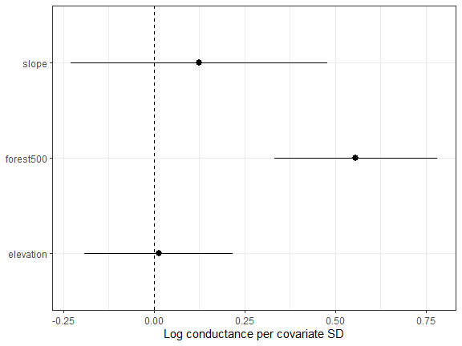
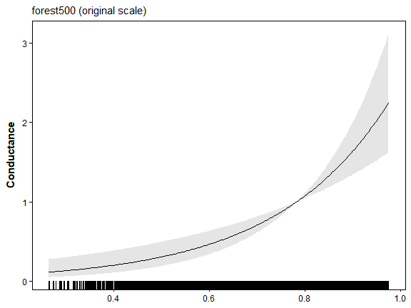
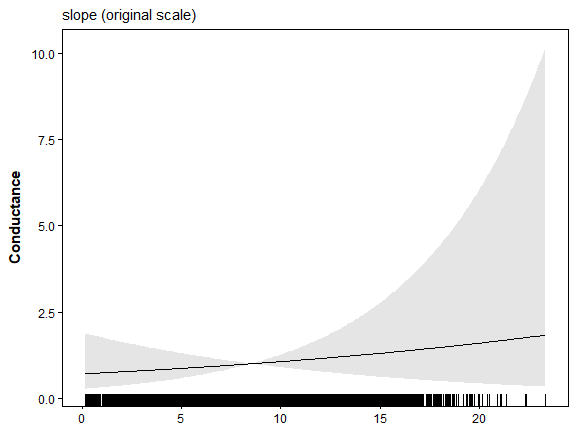
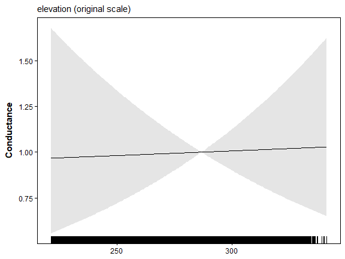
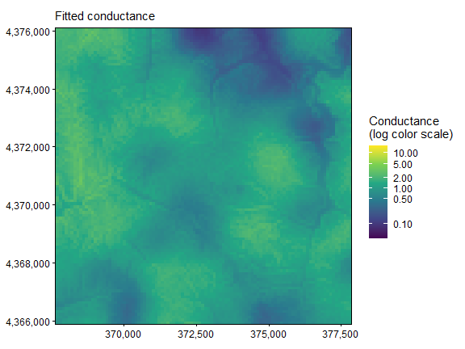
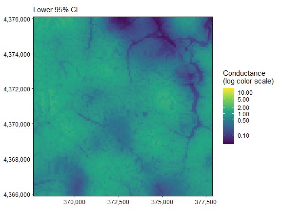
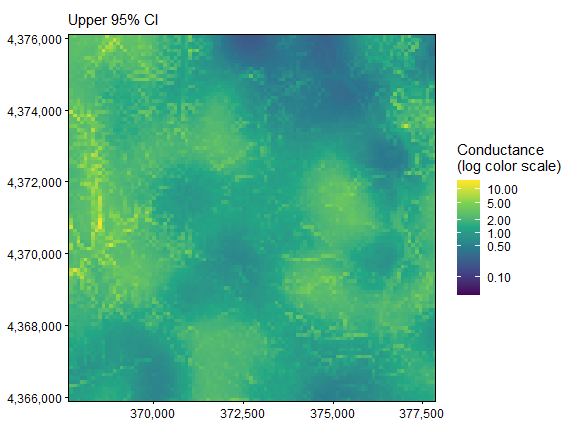
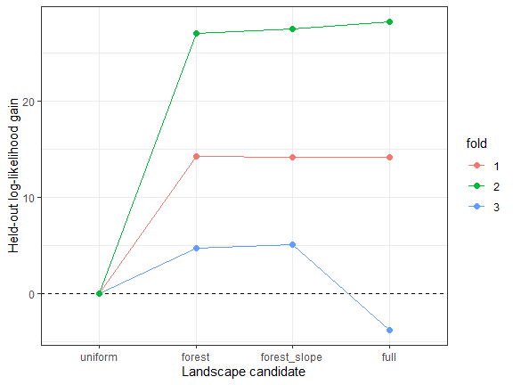

The displayed results and figures in this guide were computed from the
executable R Markdown source shipped with the package. Routine package
checks use these precomputed results to keep the CRAN check time modest.
To rerun every code chunk, copy `system.file("vignette-source", "model-comparison.Rmd", package = "terradish")` to a writable directory and render that copy with `rmarkdown::render()`.

---


**Goal.** Decide whether extra terrain variables are useful, using a candidate table, information criteria, and held-out scores.

[`vignette("data-generation", package = "terradish")`](data-generation.html)
explains the landscapes, SLiM histories, sampling, and matched markers used
in these examples.

## What evidence should choose a model?

A larger model can fit the observed genetic data better yet predict new
ponds less well. Here you compare prespecified landscape hypotheses with
information criteria, a nested likelihood-ratio test, and whole-pond
spatial validation. Start with
[`vignette("getting-started", package = "terradish")`](getting-started.html)
for raw genotypes, response construction, and measurement parameters.

In the Ohio pond simulation, forest context at 500 m affects gene flow,
while slope and elevation have no direct effect. They are realistic
candidates on the same terrain, and their spatial association with forest
can still produce apparent fitted effects. In an empirical study the
mechanism would be unknown, so competing hypotheses and validation matter
more than recovering a familiar coefficient sign.

Keep the comparison contract fixed: observed response, sampling units and
order, likelihood family, graph domain and adjacency, and assumed Wishart
information. Do not mix SNP and microsatellite likelihoods, or covariance
and distance representations, in one information-criterion table.

## Prepare one response and one landscape


``` r
library(terradish)
library(terra)
library(ggplot2)
data(ohio_ponds)
ponds <- ohio_ponds$ponds
g <- factor(ohio_ponds$samples$pond, levels = ponds$pond)
N <- 2 * as.numeric(table(g))
S <- cov_from_biallelic(rowsum(ohio_ponds$snp, g, reorder = FALSE)[ohio_ponds$ponds$pond, , drop = FALSE], N) / N[1]
x <- c(unwrap(ohio_ponds$covariates), unwrap(ohio_ponds$forest500))
surface <- conductance_surface(scale_covariates(x), ponds[c("x", "y")], directions = 8)

# Correlation describes the full raster domain, not independent sampled ponds.
round(cor(surface$x[c("forest500", "slope", "elevation")]), 2)
#>           forest500 slope elevation
#> forest500      1.00  0.33      0.39
#> slope          0.33  1.00      0.00
#> elevation      0.39  0.00      1.00
```

**How to read the output.** All three covariates are standardized over the
whole landscape, so each coefficient is the change in log conductance per
one SD, holding the other included terms fixed. Forest is correlated with
slope (0.33) and elevation (0.39), so either can absorb part of the forest
signal. Correlation among thousands of raster cells does not add
independent genetic information.

## Declare the biological candidates

Each extension keeps the active forest hypothesis:

| Candidate | Landscape hypothesis | Conductance parameters |
|---|---|---|
| `uniform` | Uniform graph with spatial separation | None |
| `forest` | Forest context alone | One |
| `forest_slope` | Forest plus an additional slope association | Two |
| `full` | Forest, slope, and elevation associations | Three |

The measurement model adds its graph weight and log diagonal variance to
every candidate, so `K` in a comparison table exceeds the number of
covariates. Here `nu = 40` is an information assumption, not 2,500
independent SNPs.

<details>
<summary>Fit the candidates and inspect all starting attempts (code and output)</summary>


``` r
formulas <- list(uniform = S ~ 1, forest = S ~ forest500,
                 forest_slope = S ~ forest500 + slope,
                 full = S ~ forest500 + slope + elevation)
control <- NewtonRaphsonControl(maxit = 200, ctol = 1e-8, ftol = 1e-8)

# Retain every starting attempt, including errors and nonconverged fits.
attempts <- list()
fit_candidate <- function(formula, label) {
  labels <- attr(terms(formula), "term.labels")
  rhs <- if (length(labels)) reformulate(labels) else ~ 1
  defaults <- attr(loglinear_conductance(rhs, surface$x), "default")
  starts <- if (length(attr(terms(formula), "term.labels"))) c(-0.5, 0, 0.5) else 0
  valid_fits <- list()
  for (start in starts) {
    theta <- defaults
    theta[] <- start
    fit <- tryCatch(terradish(formula, surface,
      measurement_model = wishart_covariance, nu = 40, theta = theta,
      optimizer = "bfgs", control = control), error = identity)
    valid <- !inherits(fit, "error") && isTRUE(fit$convergence$code == 0) &&
      isTRUE(fit$fit$subproblem$convergence == 0) && is.finite(as.numeric(logLik(fit)))
    attempts[[length(attempts) + 1L]] <<- data.frame(model = label, start,
      valid, logLik = if (inherits(fit, "error")) NA_real_ else as.numeric(logLik(fit)),
      diagnostic = if (inherits(fit, "error")) conditionMessage(fit) else
        paste("outer", fit$convergence$code, "nuisance", fit$fit$subproblem$convergence))
    if (valid) valid_fits[[length(valid_fits) + 1L]] <- fit
  }
  if (!length(valid_fits)) stop("No converged fit for ", label)
  valid_fits[[which.max(vapply(valid_fits, function(z) as.numeric(logLik(z)), numeric(1)))]]
}
fits <- Map(fit_candidate, formulas, names(formulas))
do.call(rbind, attempts)
#>           model start valid   logLik         diagnostic
#> 1       uniform   0.0  TRUE 103.7619 outer 0 nuisance 0
#> 2        forest  -0.5  TRUE 141.3124 outer 0 nuisance 0
#> 3        forest   0.0  TRUE 141.3124 outer 0 nuisance 0
#> 4        forest   0.5  TRUE 141.3124 outer 0 nuisance 0
#> 5  forest_slope  -0.5  TRUE 141.5479 outer 0 nuisance 0
#> 6  forest_slope   0.0  TRUE 141.5479 outer 0 nuisance 0
#> 7  forest_slope   0.5  TRUE 141.5479 outer 0 nuisance 0
#> 8          full  -0.5  TRUE 141.5550 outer 0 nuisance 0
#> 9          full   0.0  TRUE 141.5550 outer 0 nuisance 0
#> 10         full   0.5  TRUE 141.5550 outer 0 nuisance 0
```

**How to read the output.** Compare optima only after both conductance
and nuisance fitting converge. Agreement across starts shows numerical
stability only. Failed attempts stay in the table but are never used as
optima. If valid starts disagree materially,
investigate the likelihood surface before interpreting. Do not change
stopping thresholds to make an unresolved fit appear converged.

</details>

## Read information criteria with their assumptions


``` r
ranking <- aic_table(fits, mod_names = names(fits))
ranking
#>          model K       AIC Delta_AIC AIC_wt Cum.wt   loglik converged boundary
#> 2       forest 3 -276.6249    0.0000 0.6105 0.6105 141.3124      TRUE    FALSE
#> 3 forest_slope 4 -275.0958    1.5291 0.2842 0.8947 141.5479      TRUE    FALSE
#> 4         full 5 -273.1100    3.5149 0.1053 1.0000 141.5550      TRUE    FALSE
#> 1      uniform 2 -203.5238   73.1011 0.0000 1.0000 103.7619      TRUE    FALSE
aic_table(fits, mod_names = names(fits), AICc = TRUE)
#>          model K       AIC      AICc Delta_AICc AICc_wt Cum.wt   loglik
#> 2       forest 3 -276.6249 -275.4249     0.0000  0.7378 0.7378 141.3124
#> 3 forest_slope 4 -275.0958 -272.9905     2.4344  0.2184 0.9562 141.5479
#> 4         full 5 -273.1100 -269.7766     5.6483  0.0438 1.0000 141.5550
#> 1      uniform 2 -203.5238 -202.9524    72.4725  0.0000 1.0000 103.7619
#>   converged boundary
#> 2      TRUE    FALSE
#> 3      TRUE    FALSE
#> 4      TRUE    FALSE
#> 1      TRUE    FALSE
aic_table(fits, mod_names = names(fits), BIC = TRUE)
#>          model K       AIC       BIC Delta_BIC BIC_wt Cum.wt   loglik converged
#> 2       forest 3 -276.6249 -273.0907    0.0000 0.7625 0.7625 141.3124      TRUE
#> 3 forest_slope 4 -275.0958 -270.3836    2.7072 0.1970 0.9595 141.5479      TRUE
#> 4         full 5 -273.1100 -267.2197    5.8710 0.0405 1.0000 141.5550      TRUE
#> 1      uniform 2 -203.5238 -201.1677   71.9230 0.0000 1.0000 103.7619      TRUE
#>   boundary
#> 2    FALSE
#> 3    FALSE
#> 4    FALSE
#> 1    FALSE
```

**How to read the tables.** AIC is $-2\ell+2K$, so lower is better and
each extra parameter costs 2 units. `Delta_AIC` is the distance from the
best model, and `AIC_wt` is relative support within this candidate set,
not the probability that a model is the true mechanism. Models within 2
units of the best have comparable support. Here `forest` leads (weight
0.61), `forest_slope` is close (1.5 units), `full` trails (3.5 units), and
`uniform` has no support. `converged` is `TRUE` only when both optimizers
finished, and `boundary` flags estimates at a limit.

AICc and BIC use the 24 ponds, not the 276 pairs or 2,500 SNPs, as the
sample size. Under both, `forest_slope` falls more than 2 units behind
`forest`. Neither corrects for an uncertain `nu`, so check prediction too.

<details>
<summary>Optional: how assumed information changes a ranking</summary>


``` r
information_sensitivity <- lapply(c(20, 40, 80, 2500), function(nu) {
  scaled_fits <- lapply(fits, terradish_rescale_nu, nu = nu)
  tab <- aic_table(scaled_fits, mod_names = names(fits))
  data.frame(nu, tab[, c("model", "K", "AIC", "Delta_AIC")])
})
do.call(rbind, information_sensitivity)
#>      nu        model K         AIC Delta_AIC
#> 2    20       forest 3   -135.3124    0.0000
#> 3    20 forest_slope 4   -133.5479    1.7646
#> 4    20         full 5   -131.5550    3.7575
#> 1    20      uniform 2    -99.7619   35.5505
#> 21   40       forest 3   -276.6249    0.0000
#> 31   40 forest_slope 4   -275.0958    1.5291
#> 41   40         full 5   -273.1100    3.5149
#> 11   40      uniform 2   -203.5238   73.1011
#> 22   80       forest 3   -559.2498    0.0000
#> 32   80 forest_slope 4   -558.1916    1.0582
#> 42   80         full 5   -556.2199    3.0298
#> 12   80      uniform 2   -411.0477  148.2021
#> 33 2500 forest_slope 4 -17685.4860    0.0000
#> 43 2500         full 5 -17684.3732    1.1127
#> 23 2500       forest 3 -17658.0557   27.4303
#> 13 2500      uniform 2 -12966.2394 4719.2466
```

Rescaling `nu` leaves the coefficients unchanged but multiplies every
log-likelihood, so larger `nu` makes small likelihood gains outweigh the
complexity penalty. The `nu = 2500` rows, which treat every linked SNP as
independent, favor extra terms for that reason alone, so the SNP count is
not a safe default.

</details>

## Use a likelihood-ratio test only for a nested question

The forest-only model is nested in the full model, because setting the
slope and elevation coefficients to zero recovers it. A likelihood-ratio
test can therefore ask whether those two terms together add support.


``` r
anova(fits$forest, fits$full)
#> Likelihood ratio test: chi-square (2 df)
#> Null: ~ forest500
#> Alt: ~ forest500 + slope + elevation
#>      logLik Df   ChiSq Df(ChiSq) Pr(>Chi)
#> Null 141.31  3
#> Alt  141.56  5 0.48508         2   0.7846
```

**How to read the output.** `ChiSq` is twice the log-likelihood gain
(0.49), on 2 degrees of freedom because the full model estimates two more
parameters (`Df` 5 versus 3). With p = 0.78, the extra terms add nothing
detectable, so keep the forest-only model. The statistic scales with
`nu`, so a larger assumed `nu` would shrink this p-value without changing
the fit. Report the `nu` you used. Use the test only for nested models
fitted to the same response, likelihood, and `nu`, because `anova()` stops
with an error otherwise.

## Inspect conditional associations


``` r
interval <- confint(fits$full)
coefficients <- data.frame(variable = names(coef(fits$full)),
  estimate = as.numeric(coef(fits$full)), lower = interval[, 1], upper = interval[, 2])
ggplot(coefficients, aes(variable, estimate)) +
  geom_hline(yintercept = 0, linetype = 2) +
  geom_pointrange(aes(ymin = lower, ymax = upper)) +
  coord_flip() + theme_bw() + labs(x = NULL, y = "Log conductance per covariate SD")
```



**How to read the plot.** Exponentiate a coefficient to get the relative
conductance ratio for a one-SD contrast, holding the other covariates
constant. Each association depends on the covariates included, their
spatial support, and the response. Correlation and finite genetic history
can give slope and elevation nonzero estimates even without simulated
effects. An association is not evidence that habitat caused the genetic
pattern.

A marginal conductance plot shows each association as a curve, averaging
over the observed values of the other predictors:


``` r
plot(fits$full, type = "marginal", data = surface)
```







**How to read these panels.** An upward curve indicates increasing
conductance. Check the axis labels for original versus standardized units.
These are associations within the full model, not separate
single-predictor fits, and wide bands or sparse rug marks flag ranges
needing caution. Set `marginal_covariates = "forest500"` to show only
forest, or `support = "focal"` to evaluate only values at sampled cells.
Neither refits the model. Getting Started demonstrates the corresponding
`type = "marginal_response"` genetic-response curve.


``` r
maps <- plot(fits$full, type = "surface", data = surface)
C <- conductance(surface, fits$full)
map_limits <- range(terra::values(C), na.rm = TRUE)

# Change only the color mapping. Retain every cell and the same limits in
# the estimate and both interval panels so their colors remain comparable.
for (p in maps) {
  print(p + scale_fill_viridis_c(
    trans = "log10", limits = map_limits,
    breaks = c(0.01, 0.1, 0.5, 1, 2, 5, 10, 20),
    name = "Conductance\n(log color scale)"
  ))
}
```







The map combines forest, slope, and elevation in one surface, not three
independent resistance surfaces. Its intervals describe coefficient
uncertainty, not all uncertainty in the ecological interpretation. As in
Getting Started, the three panels share one logarithmic color scale.

## Compare spatial prediction

The provided blocks contain whole ponds, were fixed before fitting, and
have no known immediate pedigree relationships across blocks (the Gaussian
guide shows the check). The complete landscape and the globally
ascertained panel stay fixed, so this tests transfer to held-out ponds
within the same observed domain.


``` r
cv <- terradish_cv_folds(surface, formulas, folds = ponds$fold,
  model = wishart_covariance, nu = 40, nuisance = "fixed",
  optimizer = "bfgs", keep_fits = "none", control = control)
cv$results[, c("model", "fold", "loglik", "loglik_gain", "error")]
#>           model fold     loglik loglik_gain error
#> 1       uniform    3  58.752411    0.000000
#> 2       uniform    1  68.908763    0.000000
#> 3       uniform    2 -33.318439    0.000000
#> 4        forest    3  63.474314    4.721903
#> 5        forest    1  83.096136   14.187373
#> 6        forest    2  -6.286712   27.031727
#> 7  forest_slope    3  63.829375    5.076963
#> 8  forest_slope    1  83.046425   14.137662
#> 9  forest_slope    2  -5.842750   27.475689
#> 10         full    3  54.949998   -3.802414
#> 11         full    1  83.067260   14.158497
#> 12         full    2  -5.127193   28.191246
cv$summary
#>          model folds failed n_folds_ok total_loglik common_folds_total
#> 1 forest_slope     3      0          3    141.03305          141.03305
#> 2       forest     3      0          3    140.28374          140.28374
#> 3         full     3      0          3    132.89006          132.89006
#> 4      uniform     3      0          3     94.34274           94.34274
#>   n_common_folds between_repeat_sd mean_loglik total_loglik_gain
#> 1              3                NA    47.01102          46.69031
#> 2              3                NA    46.76125          45.94100
#> 3              3                NA    44.29669          38.54733
#> 4              3                NA    31.44758           0.00000
#>   mean_loglik_gain se_difference mean_difference within_one_se
#> 1         15.56344     0.0000000       0.0000000          TRUE
#> 2         15.31367     0.1519243      -0.2497704         FALSE
#> 3         12.84911     3.0890415      -2.7143281          TRUE
#> 4          0.00000     6.5051353     -15.5634379         FALSE
```

**How to read these outputs.** First confirm that `error` is empty and
`n_folds_ok` is 3 for every model, because a failed block leaves a
model's total as `NA`. Each model is fitted to two blocks and scored on
the third, with measurement parameters fixed at their training values.
Larger held-out log-likelihood is better, and `loglik_gain` is the
improvement over uniform conductance in the same block. In `cv$summary`,
`mean_difference` is a model's average per-block shortfall from the top
model, `se_difference` is its standard error, and `within_one_se` is
`TRUE` when the shortfall is smaller than that error.

With three blocks these standard errors are unstable. Here `forest` trails
`forest_slope` by only 0.25 per block, but so consistently that it is
flagged `FALSE`, while `full` trails by 2.7 yet is flagged `TRUE` because
one poor block inflates its error. Read the per-block scores, and prefer
the simpler model unless the larger one wins clearly in most blocks. By
that rule `forest` and `forest_slope` predict equally well, and both beat
`full` and `uniform`.


``` r
# Order candidates from simplest to most complex so lines connect neighbors.
cv_plot <- transform(cv$results, model = factor(model, levels = names(formulas)))
ggplot(cv_plot, aes(model, loglik_gain, group = fold, color = fold)) +
  geom_hline(yintercept = 0, linetype = 2) + geom_line() + geom_point(size = 2) +
  theme_bw() + labs(x = "Landscape candidate", y = "Held-out log-likelihood gain")
```



**How to read the plot.** Each line follows one held-out block across the
candidates. Forest plus slope has a total held-out score only
0.75
above forest alone, while the full model loses ground sharply in block 3.
Slope had no generating effect, so a gain this small is not evidence for
a slope mechanism. AIC and blocked prediction answer different questions
(fit with a complexity penalty versus transfer to new ponds); here both
favor a forest model.

## Put the evidence together

| Evidence | Question | Main limitation |
|---|---|---|
| Starting-value checks | Is the fitted optimum numerically reproducible? | Does not validate the mechanism |
| AIC and its alternatives | Which candidate balances fit and complexity? | Conditional on response, model, and effective information |
| Nested likelihood-ratio test | Do specified extra terms improve likelihood? | Requires regularity and a valid nesting argument |
| Spatial prediction | Do training associations transfer to held-out ponds? | Conditional on graph, blocks, panel ascertainment, and scoring rule |
| Simulation truth | Can a workflow recover a declared mechanism? | One simplified simulation is not field validation |

Keep your candidate set small and biologically motivated. Choosing
variables, smoothing scales, or spline sizes on all the data and then
scoring them on the same blocks inflates the scores, so make those choices
inside each training set.

<details>
<summary>Quick reference: expand for the complete copyable workflow</summary>

## Quick reference: a complete candidate comparison


``` r
library(terradish)
library(terra)
data(ohio_ponds)
g <- factor(ohio_ponds$samples$pond, levels = ohio_ponds$ponds$pond)
N <- 2 * as.numeric(table(g))
S <- cov_from_biallelic(rowsum(ohio_ponds$snp, g, reorder = FALSE)[ohio_ponds$ponds$pond, , drop = FALSE], N) / N[1]
x <- c(unwrap(ohio_ponds$covariates), unwrap(ohio_ponds$forest500))
graph <- conductance_surface(scale_covariates(x), ohio_ponds$ponds[c("x", "y")],
  directions = 8)
f <- list(uniform = S ~ 1, forest = S ~ forest500,
          forest_slope = S ~ forest500 + slope,
          full = S ~ forest500 + slope + elevation)
ctl <- NewtonRaphsonControl(maxit = 200, ctol = 1e-8, ftol = 1e-8)

# 1. Fit each declared candidate; use the multiple-start audit above in practice.
fits <- lapply(f, function(z) terradish(z, graph,
  measurement_model = wishart_covariance, nu = 40, optimizer = "bfgs", control = ctl))

# 2. Rank fits; 'converged' must be TRUE, and models within 2 AIC units tie.
aic_table(fits, mod_names = names(fits))
anova(fits$forest, fits$full)   # do slope and elevation add anything?

# 3. Score the same held-out ponds with all training parameters held fixed.
cv <- terradish_cv_folds(graph, f, ohio_ponds$ponds$fold,
  model = wishart_covariance, nu = 40, nuisance = "fixed",
  optimizer = "bfgs", control = ctl)
cv$results   # per-block held-out log-likelihood; larger is better
cv$summary   # totals, shortfall from the best model, and its standard error
```

</details>

## Summary of key functions

| Function | Purpose |
|---|---|
| `aic_table()` | Rank compatible models by AIC, AICc, or BIC |
| `terradish_rescale_nu()` | Examine the dependence of inference on assumed information |
| `anova()` | Compare nested compatible likelihood models |
| `confint()` | Read intervals on coefficient and scale parameters |
| `terradish_cv_folds()` | Compare whole-site predictive scores on a fixed graph |

## See also

- [`vignette("getting-started", package = "terradish")`](getting-started.html): response
  construction, graph conventions, and measurement parameters.
- [`vignette("gaussian-scale-optimization", package = "terradish")`](gaussian-scale-optimization.html):
  scale identification, profiles, and fixed-versus-estimated context.
- [`vignette("spline-conductance", package = "terradish")`](spline-conductance.html): nonlinear
  shape, basis coefficients, and predictive checks.
- [`vignette("categorical-conductance", package = "terradish")`](categorical-conductance.html):
  nominal class coding and reference contrasts.
- [`vignette("wishart-covariance", package = "terradish")`](wishart-covariance.html):
  how the assumed `nu` drives standard errors, tests, and AIC.
- [`vignette("ibe-ibr-workflow", package = "terradish")`](ibe-ibr-workflow.html):
  adding environmental differences between sites to the comparison.
- [`vignette("mlpe-pairwise-distance", package = "terradish")`](mlpe-pairwise-distance.html):
  pairwise genetic distances with MLPE, compared with the same AIC and
  cross-validation tools.
- [`vignette("simulation-design", package = "terradish")`](simulation-design.html):
  simulating responses to check whether a comparison can detect an effect.
