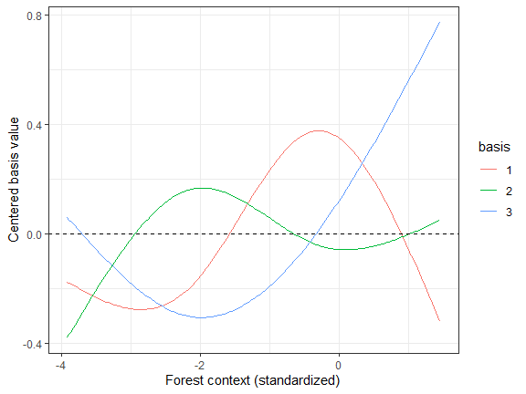
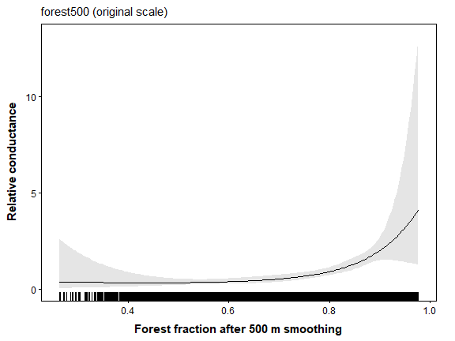
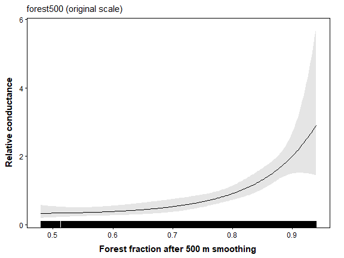
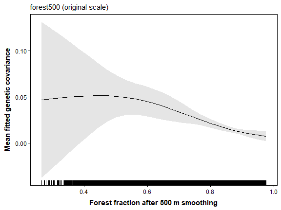
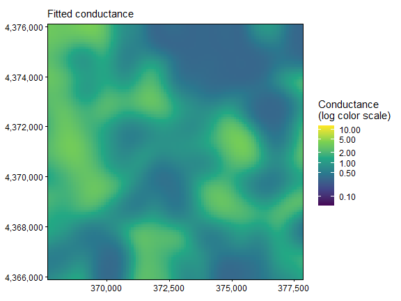
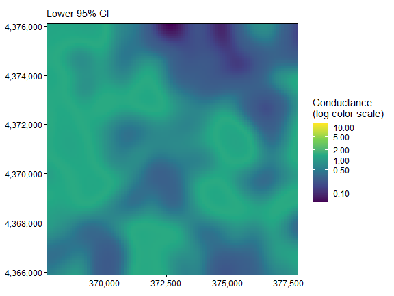
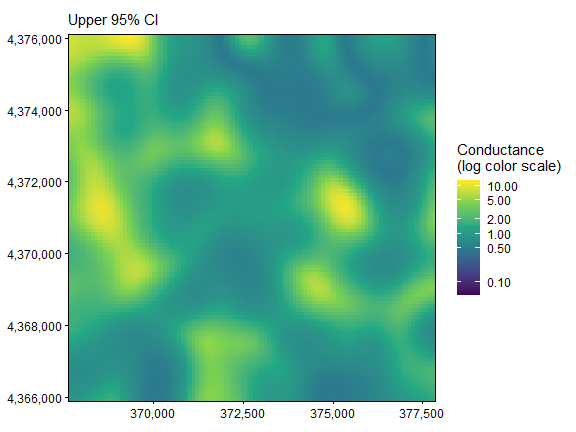

The displayed results and figures in this guide were computed from the
executable R Markdown source shipped with the package. Routine package
checks use these precomputed results to keep the CRAN check time modest.
To rerun every code chunk, copy `system.file("vignette-source", "spline-conductance.Rmd", package = "terradish")` to a writable directory and render that copy with `rmarkdown::render()`.

---


**Goal.** Decide whether a bend in the forest association is useful or just extra flexibility, reading the fitted curve and predictive comparison together.

[`vignette("data-generation", package = "terradish")`](data-generation.html)
explains the landscapes, SLiM histories, sampling, and matched markers used
in these examples.

## Shape and spatial context are different questions

Gaussian smoothing sets the spatial context of a raster covariate. A
spline sets the **shape** of its association with conductance. Start with
[`vignette("getting-started", package = "terradish")`](getting-started.html)
and [`vignette("gaussian-scale-optimization", package = "terradish")`](gaussian-scale-optimization.html)
for the shared Ohio pond response and its spatial context.

A forest association can rise steadily, level off, or change direction,
and a spline lets the data estimate such a curve. Here you hold context at
the simulated 500 m and ask whether a flexible shape improves on a
log-linear association. The simulated log-conductance is linear in that
context, so a spline should approximate it but need not improve
prediction, a check against reading a nonlinear ecological story into a
flexible curve.

For a log-linear model, $\log C_i=\theta x_i$. For a spline,

$$\log C_i=\sum_{b=1}^{q}\beta_b B_b(x_i),$$

where $B_b$ are basis functions and $q$ is the chosen number of basis
coefficients. The coefficients jointly describe one curve, so their
individual signs lack the meaning of a single log-linear slope. These are
**unpenalized regression splines**. The fit estimates no smoothing
penalty, so you set their complexity explicitly.

## Use the same genotypes and fixed context


``` r
library(terradish)
library(terra)
library(ggplot2)
data(ohio_ponds)
ponds <- ohio_ponds$ponds
g <- factor(ohio_ponds$samples$pond, levels = ponds$pond)
N <- 2 * as.numeric(table(g))
S <- cov_from_biallelic(rowsum(ohio_ponds$snp, g, reorder = FALSE)[ohio_ponds$ponds$pond, , drop = FALSE], N) / N[1]
x <- c(unwrap(ohio_ponds$covariates), unwrap(ohio_ponds$forest500))
surface <- conductance_surface(scale_covariates(x), ponds[c("x", "y")], directions = 8)
```

All cells and all 24 ponds remain in the graph, and forest context is
standardized over the whole landscape. Fixing 500 m uses the known
simulated scale, which a field study must instead justify or estimate.

## See how basis functions build a curve


``` r
grid <- seq(min(surface$x$forest500), max(surface$x$forest500), length.out = 200)
B <- splines::ns(grid, df = 3)
B <- sweep(B, 2, colMeans(B))
basis_data <- data.frame(x = rep(grid, 3), value = as.vector(B),
                         basis = factor(rep(1:3, each = length(grid))))
ggplot(basis_data, aes(x, value, color = basis)) + geom_line() +
  geom_hline(yintercept = 0, linetype = 2) + theme_bw() +
  labs(x = "Forest context (standardized)", y = "Centered basis value")
```



**How to read the plot.** Each column bends over part of the covariate
range, and their weighted sum forms the fitted shape. The fit itself
defines and stores its basis (knots, boundary knots, and centering
offsets) on the full training raster, not this display grid, and
prediction reuses that definition rather than placing new knots.

Natural splines are cubic within the boundary knots and linear beyond
them, while B-splines can behave polynomially outside their boundary
range. Neither makes unsupported extrapolation safe. `df` sets the number
of conductance coefficients for the smooth term, not an effective marker
count or an automatically selected ecological complexity.

## Fit linear and spline candidates with starting checks


``` r
control <- NewtonRaphsonControl(maxit = 200, ctol = 1e-8, ftol = 1e-8)
fit_linear <- terradish(S ~ forest500, surface,
  measurement_model = wishart_covariance, nu = 40,
  optimizer = "bfgs", control = control)

# Three basis coefficients are estimated jointly. Preserve every start's status.
defaults <- attr(smooth_loglinear_conductance(~ s(forest500, df = 3), surface$x),
                 "default")
spline_fits <- lapply(c(-0.5, 0, 0.5), function(start) {
  theta <- defaults
  theta[] <- start
  tryCatch(terradish(S ~ s(forest500, df = 3), surface,
    conductance_model = smooth_loglinear_conductance,
    measurement_model = wishart_covariance, nu = 40, theta = theta,
    optimizer = "bfgs", control = control), error = identity)
})
valid <- vapply(spline_fits, function(z) !inherits(z, "error") &&
  isTRUE(z$convergence$code == 0) && isTRUE(z$fit$subproblem$convergence == 0), logical(1))
likelihood <- vapply(spline_fits, function(z)
  if (inherits(z, "error")) NA_real_ else as.numeric(logLik(z)), numeric(1))
data.frame(start = c(-0.5, 0, 0.5), valid, logLik = likelihood)
#>   start valid   logLik
#> 1  -0.5  TRUE 143.5772
#> 2   0.0  TRUE 143.5772
#> 3   0.5  TRUE 143.5772
if (!any(valid)) stop("No converged spline candidate")
eligible <- which(valid)
fit_spline <- spline_fits[[eligible[which.max(likelihood[valid])]]]
summary(fit_spline)
#> Conductance surface with 10404 vertices (24 focal) estimated by maximum likelihood
#> Call:   terradish(formula = S ~ s(forest500, df = 3), data = surface,
#>     conductance_model = smooth_loglinear_conductance, measurement_model = wishart_covariance,
#>     nu = 40, theta = theta, optimizer = "bfgs", control = control)
#>
#> Loglikelihood: 143.5772 (5 degrees freedom)
#> AIC: -277.1545
#>
#> Number of function calls: 35
#> Number of optimization steps: 12
#> Convergence: converged | projected gradient: 2.03e-09
#> Norm of gradient at MLE: 2.785586e-09
#>
#> Nuisance parameters (conditional on fitted conductance surface; measurement-model scale):
#>        Estimate  Std. Error  Lower 95%  Upper 95%
#> tau     1.3394    0.1533      1.0390     1.6399
#> sigma  -3.0634    0.4345     -3.9150    -2.2118
#>
#> Spline shape over focal-site covariate ranges:
#>                  term  variable     lower    upper monotone  direction
#>  s(forest500, df = 3) forest500 -2.291263 1.182408     TRUE increasing
#>  derivative_sign_changes
#>                        0
#> Coefficients:
#>                Estimate Std. Error z value Pr(>|z|)
#> s(forest500).1   1.4217     0.4801   2.961 0.003065 **
#> s(forest500).2   1.7429     2.3415   0.744 0.456667
#> s(forest500).3   2.5743     0.7348   3.503 0.000459 ***
#> ---
#> Signif. codes:  0 '***' 0.001 '**' 0.01 '*' 0.05 '.' 0.1 ' ' 1
#>
#> Correlation of Coefficients:
#>                s(forest500).1 s(forest500).2
#> s(forest500).2      0.7533075
#> s(forest500).3      0.3623660      0.5814812
```

**How to read the output.** Require convergence at both levels of
fitting, and compare the likelihoods reached from several modest starts.
The spline has three conductance coefficients to the linear model's one,
read together as one curve. The measurement parameters keep their usual
meaning (see the table).

| Quantity | Where it appears | Interpretation |
|---|---|---|
| `df = 3` | Natural-spline basis | Three unpenalized conductance coefficients |
| $\beta_b$ | Weighted basis sum in log-conductance | Joint curve parameters, not individual ecological slopes |
| 500 m context | Precomputed forest raster | Spatial averaging held fixed for the shape comparison |
| `tau` and measurement `sigma` | Covariance likelihood | Graph weight and log additional diagonal variance |
| `nu = 40` | Likelihood and curvature | Assumed information, held equal across candidates |

## Interpret the fitted association and its support


``` r
plot(fit_spline, type = "marginal", data = surface) +
  labs(x = "Forest fraction after 500 m smoothing",
       y = "Relative conductance") +
  theme(plot.margin = margin(6, 18, 6, 6))
```



**How to read the curve.** Conductance stays low and nearly flat across
intermediate forest, then climbs steeply above about 0.8 forest. The
log-linear generating model also bends upward on this scale, because
conductance is the exponential of a straight line, so a bend alone is not
evidence of a threshold. The horizontal axis is back-transformed to forest
fraction. The gray band is a 95% interval at each forest value and widens
where few ponds were sampled.


``` r
focal_values <- surface$x$forest500[as.integer(surface$demes)]
rbind(domain = range(surface$x$forest500), focal = range(focal_values))
#>             [,1]     [,2]
#> domain -3.921526 1.456879
#> focal  -2.291263 1.182408
summary(fit_spline)$spline_monotonicity
#>                   term  variable     lower    upper monotone  direction
#> 1 s(forest500, df = 3) forest500 -2.291263 1.182408     TRUE increasing
#>   derivative_sign_changes
#> 1                       0
```

**How to read these outputs.** Values are in SD units of smoothed forest.
Ponds sit between
-2.3 and 1.2 SD,
while the landscape spans
-3.9 to
1.5 SD, so the curve beyond the pond
range rests on paths through the landscape rather than on sampled ponds.
The monotonicity row reports whether the curve only rises or only falls
across the pond range (`monotone`, `direction`) and how often its slope
changes sign. Here it only increases. To keep predictions inside the
sampled range, set `support = "focal"` in `plot()` or `conductance()`.
This clamps the display without refitting the model.


``` r
plot(fit_spline, type = "marginal", data = surface, support = "focal") +
  labs(x = "Forest fraction after 500 m smoothing",
       y = "Relative conductance") +
  theme(plot.margin = margin(6, 18, 6, 6))
```



## View the genetic-response curve


``` r
plot(fit_spline, type = "marginal_response", data = surface,
     marginal_covariates = "forest500", n = 25) +
  labs(x = "Forest fraction after 500 m smoothing",
       y = "Mean fitted genetic covariance")
```



**How to read this curve.** As in Getting Started, each point sets forest
to one value in every cell and averages the fitted covariance among ponds,
including each pond's variance. More forest raises conductance and shrinks the graph's contribution to
covariance, so the average falls as forest rises. With forest as the only
predictor, this is the conductance curve above, inverted and rescaled. The
band is an approximate interval for that average, not for any pond pair,
and its normal approximation can dip below zero where data are sparse.


``` r
maps <- plot(fit_spline, type = "surface", data = surface)
C <- conductance(surface, fit_spline)
map_limits <- range(terra::values(C), na.rm = TRUE)

# A shared log color scale reveals gradients without changing the fitted
# conductance values or clipping the confidence bounds.
for (p in maps) {
  print(p + scale_fill_viridis_c(
    trans = "log10", limits = map_limits,
    breaks = c(0.01, 0.1, 0.5, 1, 2, 5, 10, 20),
    name = "Conductance\n(log color scale)"
  ))
}
```







**How to read the maps.** The estimate shows where the spline assigns
high or low conductance, on a log color scale shared by all three panels.
Wide bounds where forest values have few sampled ponds call for caution,
even where the estimate looks smooth.

## Ask whether flexibility earns its extra parameters


``` r
aic_table(list(fit_linear, fit_spline), mod_names = c("linear", "spline_df3"))
#>        model K       AIC Delta_AIC AIC_wt Cum.wt   loglik converged boundary
#> 2 spline_df3 5 -277.1545    0.0000 0.5658 0.5658 143.5772      TRUE    FALSE
#> 1     linear 3 -276.6249    0.5296 0.4342 1.0000 141.3124      TRUE    FALSE
cv <- terradish_cv_folds(surface,
  list(linear = S ~ forest500, spline_df3 = S ~ s(forest500, df = 3)),
  folds = ponds$fold, model = wishart_covariance, nu = 40,
  conductance_model = list(linear = loglinear_conductance,
                           spline_df3 = smooth_loglinear_conductance),
  nuisance = "fixed", optimizer = "bfgs", keep_fits = "none", control = control)
cv$results[, c("model", "fold", "loglik", "loglik_gain", "error")]
#>        model fold     loglik loglik_gain error
#> 1     linear    3  63.474314    4.721903
#> 2     linear    1  83.096136   14.187373
#> 3     linear    2  -6.286712   27.031727
#> 4 spline_df3    3  62.531066    3.778655
#> 5 spline_df3    1  83.958923   15.050160
#> 6 spline_df3    2 -36.292265   -2.973826
cv$summary
#>        model folds failed n_folds_ok total_loglik common_folds_total
#> 1     linear     3      0          3     140.2837           140.2837
#> 2 spline_df3     3      0          3     110.1977           110.1977
#>   n_common_folds between_repeat_sd mean_loglik total_loglik_gain
#> 1              3                NA    46.76125          45.94100
#> 2              3                NA    36.73257          15.85499
#>   mean_loglik_gain se_difference mean_difference within_one_se
#> 1        15.313668       0.00000         0.00000          TRUE
#> 2         5.284996      10.00204       -10.02867         FALSE
```

**How to read the comparison.** Flexible curves can raise the full-data
likelihood even when the true shape is linear, and the AIC penalty counts
their added coefficients. Spatial validation then asks whether the
association transfers to whole held-out ponds, with measurement parameters
fixed at training values. A spline that fits better
but predicts worse favors the simpler association for this purpose.

Here the spline's AIC advantage is less than one unit, while its summed
held-out score is about
30
units below the linear model, and in block 2 it even loses to uniform
conductance. In `cv$summary`, the spline trails linear by about
10.03
units per block (standard error
10.00),
just over one standard error, so `within_one_se` is `FALSE`. The curve
rises like the simulated association, but the extra flexibility does not
improve prediction, so prefer the linear model.

## What to take to your own study

A mixed formula such as `S ~ s(forest500, df = 3) + slope` adds a linear
conditional slope association, and smoothing both variables adds more
basis coefficients. A larger `df` can represent sharper bends but can also
fit noise with only 24 ponds. Choose a small, scientifically motivated
candidate set. If you select context or spline complexity with genetic
data, do so inside training blocks before claiming predictive performance
for the selection procedure.

Natural splines are the default. Request B-splines in the formula, for
example `s(forest500, df = 3, basis = "bs")`. Do not read automatic knot
locations as biological breakpoints. Splines use a fixed spatial context,
so to estimate the smoothing scale, use a log-linear term in the Gaussian
scale model instead.

<details>
<summary>Quick reference: expand for the complete copyable workflow</summary>

## Quick reference: shape at a fixed context


``` r
library(terradish)
library(terra)
data(ohio_ponds)
g <- factor(ohio_ponds$samples$pond, levels = ohio_ponds$ponds$pond)
N <- 2 * as.numeric(table(g))
S <- cov_from_biallelic(rowsum(ohio_ponds$snp, g, reorder = FALSE)[ohio_ponds$ponds$pond, , drop = FALSE], N) / N[1]
x <- c(unwrap(ohio_ponds$covariates), unwrap(ohio_ponds$forest500))
graph <- conductance_surface(scale_covariates(x), ohio_ponds$ponds[c("x", "y")])
ctl <- NewtonRaphsonControl(maxit = 200, ctol = 1e-8, ftol = 1e-8)

# 1. Spatial context is fixed; the spline estimates response shape.
fit <- terradish(S ~ s(forest500, df = 3), graph,
  conductance_model = smooth_loglinear_conductance,
  measurement_model = wishart_covariance, nu = 40, optimizer = "bfgs", control = ctl)
summary(fit)   # check Convergence; spline monotonicity is reported at the end

# 2. Interpret the whole curve, including its supported range.
plot(fit, type = "marginal", data = graph)
plot(fit, type = "marginal", data = graph, support = "focal")

# 3. Compare prediction with a simpler log-linear shape.
cv <- terradish_cv_folds(graph,
  list(linear = S ~ forest500, spline = S ~ s(forest500, df = 3)),
  ohio_ponds$ponds$fold, model = wishart_covariance, nu = 40,
  conductance_model = list(linear = loglinear_conductance,
                           spline = smooth_loglinear_conductance),
  nuisance = "fixed", optimizer = "bfgs", control = ctl)
cv$summary
```

</details>

## Summary of key functions

| Function | Purpose |
|---|---|
| `smooth_loglinear_conductance()` | Expand specified smooth terms into a stored spline basis |
| `terradish()` | Fit basis coefficients and measurement parameters |
| `summary()` | Read estimates, convergence, and spline support diagnostics |
| `plot(..., type = "marginal")` | Interpret the combined conductance association |
| `aic_table()` | Compare compatible fits while counting spline parameters |
| `terradish_cv_folds()` | Evaluate shape candidates on common held-out ponds |

## See also

- [`vignette("getting-started", package = "terradish")`](getting-started.html): genotype
  construction and fixed-context fitting.
- [`vignette("gaussian-scale-optimization", package = "terradish")`](gaussian-scale-optimization.html):
  estimate the spatial context of a continuous raster.
- [`vignette("model-comparison", package = "terradish")`](model-comparison.html): multivariate
  candidates, information sensitivity, and predictive selection.
- [`vignette("categorical-conductance", package = "terradish")`](categorical-conductance.html):
  factors for class contrasts rather than smooth gradients.
- [`vignette("individual-salamanders", package = "terradish")`](individual-salamanders.html):
  a hump-shaped (quadratic) resistance response with individual genotypes.
- [`vignette("data-generation", package = "terradish")`](data-generation.html):
  how the pond landscape and genetic history were simulated.
